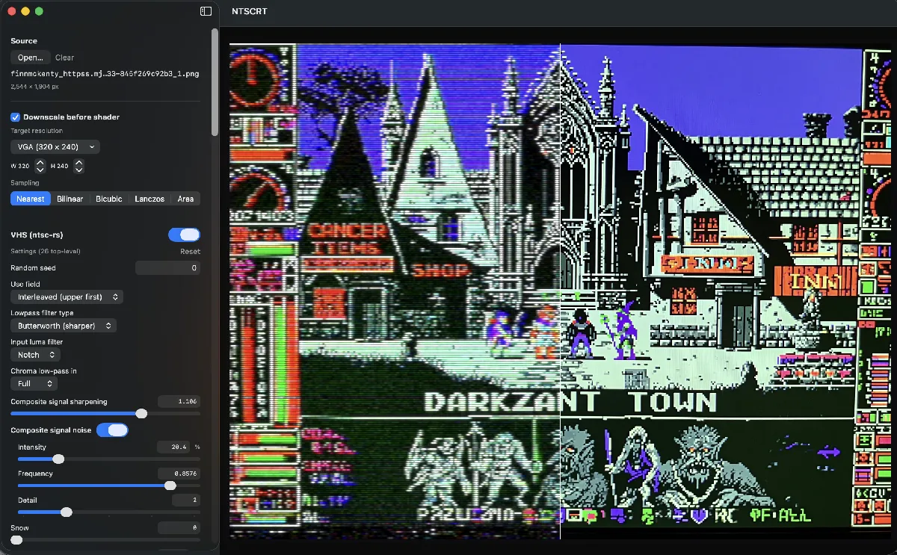

# NTSCRT



A native macOS app for recreating vintage analog TV and VHS images: [ntsc-rs](https://github.com/ntsc-rs/ntsc-rs) emulates the analog signal path (composite artifacts, tape noise, head switching), and RetroArch's CRT shaders — run through [librashader](https://github.com/SnowflakePowered/librashader), so output matches RetroArch frame-for-frame — draw the display. Pipeline: **NTSC (full res) → downscale → CRT shader**, on stills or video, with a normal mouse/keyboard UI.

To be clear about what this is: **I basically hacked two much better projects together.** All of the actual image magic is ntsc-rs and the RetroArch shader ecosystem; this repo is the SwiftUI/Metal glue between them.

## Credits

- [ntsc-rs](https://github.com/ntsc-rs/ntsc-rs) — the NTSC/VHS signal emulation (MIT/ISC/Apache-2.0). The VHS panel is generated from its own settings schema, and its preset JSON works in both apps.
- [librashader](https://github.com/SnowflakePowered/librashader) by SnowflakePowered — the RetroArch-compatible shader runtime (MPL-2.0).
- [libretro/slang-shaders](https://github.com/libretro/slang-shaders) and the RetroArch community — the CRT shader presets themselves (crt-royale by TroggleMonkey, crt-easymode/crt-aperture by EasyMode, crt-hyllian by Hyllian, crtsim, crtglow — various licenses, largely GPL).

Status:
- **Phase 1** — librashader bridge: working, all 6 shaders verified.
- **Phase 1+** — downscale pre-pass: working, all 5 sampling methods verified.
- **Phase 2** — SwiftUI app shell with sidebar (source / downscale / shader / export panels) and live MTKView preview: builds and launches. Visual verification of the window UI is pending (waiting on full Xcode for proper iteration).
- **Phase 3** — video pipeline: not yet built.

## Layout

```
Sources/
  CrtAppBridge/    Objective-C wrapper around librashader's Metal C API
  CrtCodec/        The Digital video stage's codec (pure Swift + Accelerate;
                   always compiled -O, even in debug — see below)
  CrtCore/         Shared Swift: Downscaler, Pipeline, ImageIO, presets list
  CrtSmoke/        CLI verifier: input image → optional downscale → shader → PNG
  CrtApp/          SwiftUI app: sidebar UI + MTKView preview + PNG export
Vendor/
  librashader/     librashader.dylib + headers (built locally; not in git)
  slang-shaders/   submodule of libretro/slang-shaders (preset .slangp files)
```

## Prerequisites

- macOS 14+ on Apple Silicon
- Xcode Command Line Tools (`xcode-select --install`) — enough for the CLI
- Full Xcode (App Store) — only for `swift test` (XCTest) and universal `--arch` builds; the app itself builds with the CLT
- Rust toolchain (`brew install rust`) — to build librashader from source

## Build

```sh
git submodule update --init --recursive

# Build librashader once (universal). The `stable` feature lets it compile on
# stable Rust. Homebrew's rust is host-only; install rustup for the x86_64
# target: brew install rustup && rustup toolchain install stable &&
#         rustup target add --toolchain stable x86_64-apple-darwin
# PINNED to 76462c03: newer librashader changes crt-royale rendering
# (verified ~8/255 mean pixel change). Re-run the crt-smoke byte-compare
# against current renders before ever bumping this.
git clone https://github.com/SnowflakePowered/librashader.git /tmp/librashader-src
git -C /tmp/librashader-src checkout 76462c03
TC="$HOME/.rustup/toolchains/stable-aarch64-apple-darwin"
(cd /tmp/librashader-src && RUSTC="$TC/bin/rustc" "$TC/bin/cargo" build --release -p librashader-capi --features stable --target aarch64-apple-darwin)
(cd /tmp/librashader-src && RUSTC="$TC/bin/rustc" "$TC/bin/cargo" build --release -p librashader-capi --features stable --target x86_64-apple-darwin)
lipo -create /tmp/librashader-src/target/aarch64-apple-darwin/release/liblibrashader_capi.dylib /tmp/librashader-src/target/x86_64-apple-darwin/release/liblibrashader_capi.dylib -output Vendor/librashader/librashader.dylib
install_name_tool -id @rpath/librashader.dylib Vendor/librashader/librashader.dylib

# Build the CLI verifier and the SwiftUI app.
# Use release — the app encodes GPU work on every preview draw, and debug
# (-Onone) Swift/SwiftUI glue is noticeably slower. Plain `swift build`
# (debug) still works for iteration.
swift build -c release --product crt-smoke
swift build -c release --product crt-app
```

## Windows port (in progress)

A separate Rust/wgpu version in `port/`; the Mac app doesn't use it and its build ignores the folder. It has everything the Mac app has except ProRes, the command line and MCP server included (see below). See [port/README.md](port/README.md) and [docs/windows-port-plan.md](docs/windows-port-plan.md).

## Optional: the VHS stage (ntsc-rs)

The app can run [ntsc-rs](https://github.com/ntsc-rs/ntsc-rs) as a CPU signal-degradation stage: NTSC/VHS artifacts are applied at the source's full resolution, then the degraded signal is downscaled into the CRT shader (NTSC full res → downscale → CRT). Composite artifacts, tape noise, head switching, chroma bleed — enable scale_settings → "scale with video size" for artifact sizes that track the input resolution. Build it once:

```sh
git submodule update --init --recursive   # brings in Vendor/ntsc-rs
./scripts/build-ntscrs.sh                 # cargo-builds Vendor/ntscrs-capi/ntscrs_capi.dylib
```

The "VHS (ntsc-rs)" panel appears enabled-able in the sidebar when the dylib is present (the app runs fine without it). Its controls are generated from ntsc-rs's own settings schema, and settings use ntsc-rs's preset JSON format — presets copy/paste both ways with the ntsc-rs desktop app. Turn on **Animate** in the view palette (floating over the preview) to see noise, jitter, and tracking move; frame-seeded randomness means exports are deterministic.

Env overrides: `CRT_NTSCRS=<dylib path>`, `CRT_NTSC=1` (start with the stage enabled).

## Tests

```sh
./scripts/test.sh
```

Covers the preview's sizing rules — that integer scale snaps to whole
multiples of the chain input and letterboxes, that the chain still renders at
enough rows per source line for the shader to look the same at any window
size, and that the step between the two stays an exact integer factor. Those
requirements pull against each other, and a fix for one silently broke the
other once. `scripts/make-release.sh` runs the suite as a gate.

```sh
scripts/check-control-strength.py            # ~2 min
scripts/check-control-strength.py --update   # after a deliberate change
```

Every NTSC, Glitch, VCR and Digital video control, rendered at its minimum,
middle and maximum under the default look, measured against it (mean RGB
difference) and compared with `scripts/control-strength-baseline.json` — in the default look
and, for NTSC and Glitch, with a Chunky and a Smooth 320 Downscale, a 4K
source and the VCR off. It fails when a control goes dead or its strength
moves past 1.6× either way — and when a slider that starts at its minimum
has a flat spot: under 10% of its effect at half its travel, or under 30% at
three quarters (Wear in 0.27.0: 5% at half). Wear, Oxide flaws, Scratches and
Edge damage follow measured curves (`TapeParams.curves`, the picture's change
growing as the slider to the power 1.5); looks saved before version 3 are
converted on loading (`GlitchSettings.upgraded`) so they damage the tape the
same. It exists because changes to one panel kept
weakening another's controls without anything failing: Wear did almost
nothing at 100%, Flutter nothing visible, Digital video's values were dropped from the command line. After a deliberate change, `--update`
and read the baseline's diff: it lists every control the change moved.
`make-release.sh` runs it as a gate. `--app <binary>` checks another build
against the baseline.

The wrapper exists because XCTest ships with full Xcode, not the Command Line
Tools, and `xcode-select` here points at the CLT — so it sets `DEVELOPER_DIR`
for the test run only (no `sudo xcode-select` needed) and uses its own scratch
path, since the two toolchains can't share a build database. Plain
`swift test` works too if `xcode-select -p` already points at Xcode.

## Bundled presets

Drop a `.json` look preset into `presets/` and rebuild — `wrap-app.sh` and
`make-release.sh` copy the folder into `Contents/Resources/presets`, and the
app lists whatever it finds there under Save/Load in the Preset menu, named
after the file. No code change needed to add one.

## Dev hooks (env vars)

For iteration and headless/screenshot verification:

- `CRT_SOURCE=<path>` — preload an image or video at launch
- `CRT_PRESET=<id>` — start on a shader preset (ids in `Presets.swift`, e.g. `royale`, `hyllian`)
- `CRT_NTSC=1` — start with the VHS stage enabled
- `CRT_NTSCRS` / `CRT_LIBRASHADER` / `CRT_PRESETS` — override dylib/shader locations
- `CRT_UPDATE_URL=<url or release JSON file>`, `CRT_UPDATE_VERSION=<version>`, `CRT_UPDATE_CHECK=0` — the update check (`UpdateChecker.swift`, rules in CrtCore's `UpdateCheck`): another feed, a pretend version, or no check at launch. Other `CRT_*` hooks skip the launch check unless `CRT_UPDATE_URL` is set
- `CRT_PERF_LOG=1` — log chain-render vs composite-only draws, plus fps / ms-per-draw / main-thread duty cycle every 60 frames
- `CRT_DUMP_CONTROLS=1` — print the param→control classification for every preset, then exit
- `CRT_FORCE_MANAGED=1` — use `.managed` CPU-readback textures (the discrete-GPU path) even on unified memory
- `CRT_PALETTE_FADE=<seconds>` — override the floating view palette's 2 s idle fade
- `CRT_SHOW_EXPORT=1` — open the Export popover at launch
- `CRT_TIMELINE=1` — open the keyframe timeline at launch (image sources)
- `CRT_TL_DEMO=1` — open the timeline and drop two demo keyframes on it
- `CRT_TL_SELFTEST=<out.mp4>` — headless end-to-end check of the keyframe export: builds a two-key animation, renders it to `<out.mp4>`, exits
- `CRT_GIF_SELFTEST=<out.gif>` — render a GIF headlessly and exit (image source → keyframed GIF, video source → decimated GIF). `CRT_GIF_W`, `CRT_GIF_FPS`, `CRT_GIF_SECONDS` override the defaults and `CRT_GIF_PLAIN=1` skips the keyframes; the run prints bytes-per-pixel-per-frame, which is how `GifExporter.estimatedBytes` was calibrated
- `CRT_EXPORT_FORMAT=<GIF|H.264|…>` — preselect an export format at launch
- `CRT_SNAP=1` — turn on "snap size to scanline grid" at launch
- `CRT_NTSC_OFF=1` / `CRT_NTSC_SET="key=value,…"` — disable the VHS stage, or set individual ntsc-rs values, to bisect a rendering artifact
- `CRT_INTEGER_OFF=1` / `CRT_COMPARE_OFF=1` — start with integer scale or compare off (compare already starts off since 2026-10; `CRT_COMPARE_X` turns it on)
- `CRT_WINDOW_SIZE=WxH` — force the window size, so both letterbox parities can be reproduced deliberately
- `CRT_SCALE_LOG=1` — log drawable/target sizes and letterbox parity on each size change
- `CRT_PANEL_BENCH=1` — time showing/hiding each VHS group's children and exit (`CRT_PANEL_BENCH_ORDER=a,b,c` picks the groups). Collapsing near the TOP of the panel costs more, since every row below is re-laid out — measured 40 ms for the first group vs ~9 ms mid-list
- `CRT_NO_HOUSE_ORDER=1` — keep ntsc-rs's own setting order (Intensity not hoisted), for that A/B
- `CRT_DUMP_NTSC_LAYOUT=1` — print the NTSC panel's grouping/label tree and exit (verifies `NtscSetting.houseLayout`)
- `CRT_LOAD_BUILTIN=<name>` — list the bundled presets, load one by name, report what it restored (and whether it opened the timeline), then exit
- `CRT_HOWL="zoom=0.8,center_x=0.1,drift_y=-0.2"` sets Screen Loop knobs for the other Screen Loop hooks (0.13's ids and drift/drift_dir are read too, via `HowlaroundParam.migrated`)
- `CRT_HOWL_RENDER=<out.mp4|out.gif>` — render a howlaround through the panel's own render call (`AppState.renderHowlaround`, settings from the Export builders) and exit; `CRT_HOWL_SECONDS` sets a still's length, `CRT_HOWL_DRAFT=1` makes it the draft (480 px)
- `CRT_FEEDBACK_PRESET_CHECK=1` — a Screen Loop preset saves and loads back exactly, a 0.13 preset (British ids, drift as distance + direction) loads into today's ids with the same move, and the look presets refuse one with a pointer to the panel
- `CRT_PAD_E2E=1` — the vanishing-point dots on the real panel, over the real draft player, driven by mouse and key events through AppKit: arrow keys do nothing before a dot is clicked; drag the dot (the ring comes along when there's no drift), pull the ring out, drag the dot again (the ring stays), drag the arrow (both move), arrow keys and Shift-arrow nudge, the ring snaps back onto the dot, double-clicks reset each, clicks elsewhere change nothing, and the readout follows
- `CRT_HOWL_DRAFT_CHECK=1` — the panel's draft logic: a first draft; quick knob turns render only the last setting; a turn mid-render cancels it; never two renders at once
- `CRT_SHOW_HOWL=1` opens the Howlaround panel at launch; `CRT_HOWL_PANEL_SNAPSHOT=<out.png>` draws it off screen (the draft video itself doesn't draw that way)
- `CRT_LOOK=<path>` — open with any look file loaded (not just a bundled preset), for rendering or inspecting it
- `CRT_SAVE_LOOK=<path>` — write the state the app opened with as a look file, then exit. Changing the launch defaults: save the reference look from the app, then diff it against this output — they should be identical
- `CRT_LOOK_PRESETS=<dir>` — override where bundled look presets are read from
- `CRT_PLAY_BENCH=<seconds>` — play the loaded video and report displayed fps + drops (`CRT_BENCH_OUT=<file>` writes the result to a file). **Timing benches must run via `open build/NTSCRT.app --env …`**: a binary exec'd from a background shell gets a QoS clamp that throttles every main-thread timer (Task.sleep, CVDisplayLink, CADisplayLink all fire at ~15 Hz), which corrupts the numbers while leaving work-bound measurements plausible
- `CRT_PERF_LOG=1` during playback also prints producer stage times, display-link draw gaps, frame-cache hits, and `[prerender]` completion lines
- `CRT_GLITCH="id=value,…"` — switch the Glitch stage on with these knobs (`GlitchParam` ids, e.g. `vertical_hold=0.5,signal_strength=0.3`), for headless captures with `CRT_COMPOSITE_DUMP`
- `CRT_GLITCH_EXPORT_CHECK=<dir>` — export every route the source offers through the Export buttons' own builders with the Glitch stage off, on-and-healthy, and on-and-broken; the healthy export must match the off one (measured: 0.00 mean difference on all five routes) and the broken one must not (`GLITCHCHK PASS/FAIL`). The wiring counterpart to `ExportGlitchTests`
- `CRT_SLIDER_SELFTEST=1` — double-click-to-neutral checked below the UI: synthesized double-click events on a `NeutralSlider`'s knob and track, then every slider in every panel (NTSC, all seven CRT presets) must have an explicit entry in `NeutralValues.swift`; prints each resolved neutral value for review
- `CRT_FIELD_FOCUS_CHECK=1` — a number field that has keyboard focus while its slider moves the value keeps the new value when focus leaves (it used to commit its stale text: the Screen Loop panel focused Zoom's field on opening, and opening the export settings reset Zoom); typed values still commit
- `CRT_SLIDER_E2E=1` — the whole double-click path on real sidebar sliders (Glitch, NTSC, CRT): a double-click through AppKit's event queue onto the knob, then the stored value, the number field and the knob position (watched for 1.2 s — it must stay) must reset, and the export must differ from before and match setting the neutral value directly
- `CRT_SPACE_SELFTEST=1` — Space through the app's own event queue (the path a real key press takes): play/pause with the timeline open, tap-vs-pan when zoomed, nothing with the timeline closed
- `CRT_GLITCH_PANEL_SNAPSHOT=<out.png>` — render the Glitch panel on its own and exit (it sits below the NTSC list, out of reach of a window capture)
- `CRT_CROP="9:16"`, `"9:16@0.2"` (both places), `"9:16@0.2,0.7"` (x, y), each optionally `"*1.5"` (zoomed in) — start with the source cropped
- `CRT_CROP_CHECK=<dir>` (with `CRT_SOURCE=<picture or clip in quadrants: red, blue / green, yellow>`) — the crop through the app: what's on screen, the sizes that follow (aspect, downscale height, export size), PNG from each side (colors), a clip's MP4 through `mp4ExportSettings`, playback frames (clean and VHS-baked), a look saving/restoring the crop and a look without one leaving it alone. Run it on both a picture and a clip
- `CRT_CROP_DRAG_CHECK=<dir>` (with `CRT_SOURCE=<wide quadrant picture or clip>`) — the crop on the preview through PreviewMTKView's own mouse handlers (plus a hit test that a real click lands on the preview): a move sized for middle → a quarter lands at 0.25 with the uncropped context loaded meanwhile; double-click centers; past the end it holds; the bottom-right corner dragged halfway in shows the new size without applying it, and the release halves the crop with its top-left corner kept (capture in `<dir>/resizing.png`); zoomed in it moves both ways; double-click a corner restores scale 1; a 2:1 crop moves up/down; zoomed in, no adjusting
- `CRT_VIDEO_PNG_CHECK=<dir>` (with `CRT_SOURCE=<clip of 42+ frames>`) — PNG export from a video, through `exportPNG` (the Export button's call): frames 10 and 40 differ, frame 10 exported twice is byte-identical, size = export size; also draws the Export popover to `<dir>/popover.png`. A video frame's VHS noise (and the shader's frame count) is seeded by frame number + 1, as in a video export — with the preview's display counter, the same frame came out different each time (mutation-checked). PNG was image-only from 0.3.0 to 0.14.0; Finn: "PNG export should always be an option".
- `CRT_VIEWPORT_CHECK=<dir>` (with `CRT_SOURCE=<image>`; TestAssets/flat-gray.png keeps the edge test unambiguous) — Export viewport through `exportViewport` (the button's call), at fit and at 241% zoom panned so the picture spills into the letterbox bars: each file is the size the preview reports, at display pixels (points × backing scale), tagged 72 × scale dpi, with picture rather than the composite's background (0.05, 0.05, 0.06) along all four edges; also draws the Export popover to `<dir>/popover.png`. Export viewport copies the presented drawable, not a re-render: `AppState.viewportCaptureRequest` is taken by the next `PreviewView.draw`, which blits `PreviewGeometry.visiblePicture` (the pixels whose centers sample inside the image, unit-tested against `uv(px:py:)`) out of the drawable before presenting. Overlays drawn by SwiftUI (palette, crop handles) aren't in the drawable, so they never appear; the compare split does.
- `CRT_DIGITAL="minidv"` or `"video_call,data_loss=0.5"` — switch the Digital video stage on with a format (`DigitalFormat` ids), then knobs (`DigitalParam` ids).
- `CRT_DIGITAL_CHECK=<dir>` (with `CRT_SOURCE=<clip of 100+ frames>`, ideally with motion and a cut — e.g. ffmpeg `testsrc2` concatenated with `life`) — the Digital video stage across its paths, NTSC off: the pre-render producer (the playback path, every frame in order) fills the frame cache, then frames are jumped to out of order on the main thread (re-running from keyframes and datamosh checkpoints, decoding earlier frames) and each must equal the cached chain input byte for byte. Also: a format sets the Downscale, edited values read as Custom, MP4 and GIF exports run with it, a look round-trips it; draws the panel to `<dir>/panel.png`.
- `CRT_DIGITAL_GALLERY=<dir>` (with a still) — every format's chain input (the stage alone, at its capture size, frame 9) as `<dir>/<format>.png`.
- `CRT_EXPORT_TOGGLE_CHECK=<dir>` — export every route the loaded source offers (image: PNG, video-from-still, GIF; video: MP4, GIF) with the CRT toggle on and then off, through the same `AppState` settings builders and `exportPNG` the Export buttons call, and require scanlines with it on and none with it off (`TOGGLECHK PASS/FAIL` per route). `scripts/check-export-toggles.sh` runs it for an image and a video. Background: until 0.11.1 no export route read `shaderEnabled`, so exports always had the CRT on. The exporters now render every frame through `ExportFrame.encode` (nil chain = shader off → `ShaderBypass`), `shaderEnabled` is a **required** argument of both exporters' `Settings` so a new call site can't forget it, and `ExportShaderToggleTests` (release gate) runs every exporter both ways with the real shader. The gate can't see the buttons' wiring — this hook can; run it when touching `ExportPopover`, the builders in `AppState`, or the exporters. **Rule: Export buttons and headless checks must build settings through the same `AppState` builder** — both shipped export bugs (this and the ignored Loop count) hid behind checks that built their own
- `CRT_CACHE_CHECK=<out.png>` — play the clip so the cache fills, then dump the composite at a fixed frame on loop two, asserting it was served from the cache; the same run with `CRT_FRAME_CACHE_OFF=1` dumps the live frame on loop one. `cmp` the two files — they must be byte-identical (verified: they are). Launch both via `open … --env` (see the QoS note under `CRT_PLAY_BENCH`)
- `CRT_FRAME_CACHE_OFF=1` — disable the RAM-preview frame cache (`ChainInputCache`) and the paused pre-render, for A/B runs. With the cache on, the producer skips the NTSC step for frames the cache already holds and the preview serves them straight from cached chain-input textures; anything upstream of the shader (NTSC settings/toggle, downscale, timeline) bumps `ntscGeneration`, which invalidates the whole cache
- `CRT_PLAY_FRAME_CHECK=<n>` — play to frame n, then verify the decoded frame matches the *seeked* frame n more closely than its neighbors (guards against the sequential decoder drifting out of step). It plays in real time, so frame 18000 takes ten minutes. `CRT_PLAY_FRAME_WINDOW=<k>` compares k neighbors either side instead of 2; `CRT_PLAY_FRAME_DUMP=<dir>` writes the frame playback stopped on and the same index scrubbed to as PNGs — with a clip that shows its frame number (ffmpeg `testsrc2`) the two can be read
- `CRT_FORCE_SEEK_DECODE=1` — decode playback frames by seeking to each one (the old, slow path; also what rotated tracks use); it keeps to the clock by skipping frames (it shows every frame, slowly, only with Digital video on)
- `CRT_AUDIO_MUTE=1` — play a video's sound at zero volume (use it for every bench and check that plays a clip: the player still runs, nothing comes out of the speakers); `CRT_AUDIO_OFF=1` — no audio player at all. `CRT_PERF_LOG=1` prints `[audio]` lines during playback: how far the sound is from the frame just shown, or that it is silent
- `CRT_LOOP_TEST=<out.mp4>` / `CRT_STILL_LOOP_TEST=<out.mp4>` (+ `CRT_LOOP_N=<n>`, `CRT_LOOP_CODEC="ProRes 422"` etc. for the video hook — match the output extension, `.mov` for ProRes) — export a looped video from a clip or a still and report the frame count, for checking duration and audio continuity. The video hook sets `exportLoopCount` and builds its settings with `AppState.videoExportSettings` — the same builder the Export button uses — then prints `LOOP PASS/FAIL` from the written file's duration; it used to pass `loopCount` straight to the exporter, which is how the button ignoring the Loop field went unnoticed from 0.9.0 to 0.11.0. To check a reported audio problem, synthesize a matching source with ffmpeg (e.g. `-c:v prores_ks -profile:v 2 -c:a pcm_s16le -timecode 01:00:00:00`), export with `CRT_LOOP_N=1`, then `ffprobe` the result and run `-af volumedetect` on its first and last seconds
- `CRT_VIDEO_TL_TEST=<out.gif>` — keyframe a *video* source headlessly and assert the timeline follows the clip: length from the clip, scrubbing seeks it, playhead quantizes to frames, editing while parked rewrites the key (half-frame tolerance), and a keyframed export renders
- `CRT_PRESET_ROUNDTRIP=<out.json>` — save a preset with a keyframed timeline, wipe the state, load it back, and assert duration/frame rate/keyframe times/easings/captured values all survived; prints PASS/FAIL and exits
- `CRT_TL_AUTOKEY_TEST=1` — assert the auto-key rules (edit on a keyframe rewrites it, edits between keyframes don't, scrubbing never mutates), print PASS/FAIL, exit
- `CRT_COMPARE_X=<0…1>` — place the compare divider at launch (edge-case captures)
- `CRT_ZOOM=<factor>` — start zoomed in, for capturing the pixel-inspection path. The preview view spans the whole preview area (since 2026-11-20; it used to be sized to the source's shape by SwiftUI): `PreviewScaler.plan` fits the picture inside it less an 8 pt margin, so at zoom 1 it looks as before, and zoomed in the picture spills past that frame into the letterbox until it fills the view. The pan limit (`PreviewGeometry.panLimit`) counts the view beyond the frame, and the compare line is kept on the visible picture. Zoomed composites must sample the full-resolution render, not the display-fit texture — the fit's box average can flatten scanlines entirely. The preview's sizing and sampling are now pure, tested code in CrtCore: `PreviewScaler.plan` (sizes: both modes render at the scanline floor and fit to the window), `PreviewGeometry` (the drawable→texture mapping the shader applies; `uv(px:py:)` mirrors the MSL) and `PreviewCompositor` (fit + composite, driven offscreen by `PreviewCompositorTests` with a synthetic scanline render). Those tests are in the release gate and cover every preview bug that shipped — odd-letterbox row duplication, zoom framing across the integer toggle, scanlines under zoom. `scripts/check-zoom-scanlines.sh` remains as the in-app spot check
- `CRT_DOWNSCALE_W=<px>` — set the downscale width at launch (reproduce reports at an exact chain-input size)
- `CRT_COMPOSITE_DUMP=<out.png>` — write the drawable's actual pixels once the preview settles. **This is the only trustworthy way to measure preview pixels:** `screencapture -l` returns a 1× image of a 2× window, which halves scanline detail and corrupts any modulation measurement. Also note the *signed app bundle* must be launched via `open … --env` — exec'ing its binary directly from a shell never registers with the window server, so no window appears at all (the unsandboxed `.build/release/crt-app` is fine either way)
- `CRT_FRONT=1` — activate the app at launch
- `CRT_ABOUT_SNAPSHOT=<out.png>` — open NTSCRT › About NTSCRT (`AboutPanel`: the standard panel with "by Finn Mckenty", finnmckenty.com and the X profile as its credits), capture its window to a PNG (`screencapture -l`, so Screen Recording permission), print its text and each link's address, exit
- `CRT_UPDATE_SNAPSHOT=<out.png>` (with `CRT_UPDATE_URL=<release JSON file>` and `CRT_UPDATE_VERSION=<older version>`) — capture the prompt that offers a release, which carries the same credit as one line under the release notes (`AboutPanel.creditLine`), print the line and its links, exit
- `CRT_DUMP_TOOLTIPS=1` — print every NSView carrying tooltip text, plus what a click at its center hits, then exit
- `CRT_HOVER_LOG=1` — log preview hover events and the palette's measured frame
- `CRT_PRESET_CYCLE=<seconds>` — load every bundled look in turn (`CRT_PRESET_CYCLE_PLAY=1` plays the source video meanwhile; `CRT_PRESET_CYCLE_ONLY="A|B"` picks looks) and print, per look, the longest main-thread stall, frames shown per second and process/GPU memory; then load each look after four different ones and report any setting that depends on the previous look (`CARRY-NONE` = none; skip with `CRT_PRESET_CYCLE_NO_CARRY=1`). `CRT_STALL_SAMPLE_DIR=<dir>` runs `sample(1)` on the app while the main thread is stuck over 0.4 s (run it outside the sandbox). **Keep the display awake** (`caffeinate -u`): with it asleep the preview never draws and every number is meaningless
- `CRT_EDIT_BENCH=<look name>` — load that look (paused; `CRT_EDIT_BENCH_FRAME=<n>` seeks first) and report the main-thread stall one knob change causes in each panel. A VCR knob 55 s into a clip was ~2 s before the receiver's long re-runs moved off the main thread; `CRT_RERUN_LOG=1` logs those background re-runs starting, cancelling and landing
- `CRT_CHAIN_BENCH=1` — time picking each CRT shader, first (compile) and again (cached)

**Verifying hover/tooltip behavior:** `CGWarpMouseCursorPosition` moves the cursor *without* posting events, so it cannot drive SwiftUI's `.onHover`/`.onContinuousHover` (AppKit's tooltip manager polls the cursor, so tooltips *do* appear that way — an easy false positive). Real synthetic movement needs `CGEventPost`, which needs Accessibility. Use `CRT_DUMP_TOOLTIPS`/`CRT_HOVER_LOG` for ground truth instead of screenshots.

## Licenses

NTSCRT's own code is MIT (`LICENSE`). Everything bundled keeps its own license, and binary copies have to carry the notices: `THIRD_PARTY_NOTICES.md` (readable summary) and `licenses/` (full texts) are copied into `Contents/Resources` by both `wrap-app.sh` and `make-release.sh`. Reviewed 2026-11-10:

- ntsc-rs core + `ntscrs-capi`: MIT OR ISC OR Apache-2.0 (only ntsc-rs's GUI crate is GPL-3.0, and it isn't used).
- librashader runtime: MPL-2.0 OR GPL-3.0-only, distributed under MPL-2.0 (file-level copyleft; doesn't reach NTSCRT's code). MPL requires telling recipients where the source is: the notice points at the pinned commit. **Bumping the pinned librashader commit means updating that commit in THIRD_PARTY_NOTICES.md.** Its C headers in `CrtAppBridge/include` are MIT (chyyran).
- Rust crates statically inside the two dylibs: 214, all permissive except librashader's own and two MPL-2.0 crates. After changing either library's dependencies, regenerate `licenses/rust-crates.txt`: `scripts/gen-rust-licenses.py <librashader checkout at the pinned commit>` (needs the rustup toolchain; Homebrew's cargo is broken here by a missing libllhttp).
- slang-shaders: per-file licenses, no collection license; the bundled `crt/` + `include/` tree is ~130 GPL files, ~60 MIT, some BSD and public domain, and many with no notice. Shipped unmodified, as source, as separate works loaded at runtime; GPL-2.0 and GPL-3.0 texts are in `licenses/`.

## Releasing (signed + notarized DMG)

One-time setup (requires an Apple Developer Program membership):

1. Create a **Developer ID Application** certificate: developer.apple.com → Account → Certificates → "+" → Developer ID Application. Create the CSR with Keychain Access (Certificate Assistant → Request a Certificate From a Certificate Authority), upload it, download the .cer and double-click to install.
2. Store notarization credentials (uses an app-specific password from appleid.apple.com → Sign-In and Security):

   ```sh
   xcrun notarytool store-credentials ntscrt-notary --apple-id YOU@EXAMPLE.COM --team-id YOURTEAMID
   ```

Then every release is (0.23.0 as the example):

```sh
./scripts/make-release.sh 0.23.0
git tag v0.23.0 && git push origin v0.23.0
# The tag's Windows CI run builds the package stamped 0.23.0; once it passes:
gh run download <run id> -n NTSCRT-windows-x64 -D build/ci-0.23.0
(cd build/ci-0.23.0 && zip -qr -X ../../dist/NTSCRT-0.23.0-windows-x64.zip NTSCRT)
./scripts/make-mcpb.sh 0.23.0      # the Claude Desktop extension, after make-release (it empties dist/)
gh release create v0.23.0 dist/NTSCRT-0.23.0.dmg dist/NTSCRT-0.23.0-windows-x64.zip dist/ntscrt-mcp-0.23.0.mcpb --title "NTSCRT 0.23.0" --notes-file notes.md
```

Publishing the release with `ntscrt-mcp-<v>.mcpb` attached runs the **MCP Registry** workflow, which lists that version in the official MCP Registry (`io.github.finnmckenty/ntscrt`, from `server.json`) by GitHub OIDC; no secret. Re-run it by hand with the tag if it fails. The extension (`mcpb/`) is only a launcher that finds the installed app (Applications, else Spotlight by bundle id) and runs `NTSCRT mcp`, with a clear error when NTSCRT is missing or older than 0.26. On Windows (`platform_overrides.win32`: `cmd.exe /d /c launch.cmd`) it reads `HKCU\Software\NTSCRT` (`Path`, `Version`), which `ntscrt.exe` writes each time its window opens from a lasting folder (`claude::remember_location`), else looks in the usual unzip places for a package that has `ntscrt-cli.exe`; same two errors. `launch.cmd` must keep CRLF line endings (`.gitattributes`).

Tag first: the Windows build takes its version from the tag (`git describe`), and both apps' update check compares their version with the latest release's tag. A Windows package built before the tag would call itself 0.22.1-n-g… and keep offering 0.23.0 to people who already have it.

- `make-release.sh` empties `dist/` first, so zip the Windows package after it.
- Notarization failing with "HTTP status code: 403. A required agreement is missing or has expired" means Apple has a new Developer Program agreement to accept at developer.apple.com (the account holder has to do it). It can take a few minutes to take effect; `xcrun notarytool history --keychain-profile ntscrt-notary` works once it has.

The script builds everything, assembles a fully self-contained bundle (shaders in Resources/, both dylibs in Frameworks/), signs with hardened runtime, notarizes, staples, and produces a drag-to-Applications DMG. `--adhoc` skips signing/notarization for local testing.

## Run the SwiftUI app

Two options.

### Bare CLI (quick iteration)

```sh
./.build/release/crt-app
```

The window may open behind other windows because SPM-built executables aren't proper `.app` bundles, so macOS treats them as background processes. Click Cmd-Tab to focus.

**Don't `open` the bare executable or double-click it in Finder** — Launch Services may hand it to Xcode for "editing".

### As a proper Mac app (recommended)

```sh
./scripts/wrap-app.sh
open build/NTSCRT.app
```

The script builds the binary (`swift build -c release --product crt-app`), wraps it in `build/NTSCRT.app` with a minimal `Info.plist`, embeds `librashader.dylib` under `Contents/Frameworks/`, ad-hoc signs it, and bakes the absolute path of `Vendor/slang-shaders/` into `LSEnvironment.CRT_PRESETS` so it can find presets from any launch context. Re-run after any change. Release by default; pass `debug` for a debug build. (It used to wrap whatever binary the last build left while stamping the current git version into the title, so a stale binary could claim to be the new code — it builds first since 2026-10-05.)

### How it finds external assets

In order:

1. `CRT_LIBRASHADER` and `CRT_PRESETS` env vars
2. Walking up from the executable looking for `Vendor/librashader/librashader.dylib` and `Vendor/slang-shaders/`

The bare CLI relies on (2). The wrapped `.app` baked-in `LSEnvironment` makes (1) work regardless of cwd.

## Command line (`NTSCRT render`) and the MCP server

The app binary doubles as a command-line tool. `Sources/CrtApp/CLI/Launch.swift` is the `@main`: when the first argument is `render`, `describe`, `looks`, `mcp` or `help` it runs that without a window (activation policy `.prohibited`, `RunLoop.main`); anything else calls `CrtAppApp.main()`. In dev: `.build/debug/crt-app render …`.

- **Same code as the buttons**: `render` builds a real `AppState`, loads the source, applies the settings, and calls `AppState.exportMovie` / `exportPNG` (`AppState+Export.swift`), which the Export popover calls too. Nothing is reimplemented, so a CLI render is what the button would have written.
- **stdout is the result**: `CLI.start` points fd 1 at stderr and keeps the real stdout for one JSON line (`{"ok":…,"outputs":[…],"look":{…},"plan":{…}}`). App `print`s and progress (`{"progress":0.4,"eta":12}`) go to stderr. Exit 0 ok, 1 render failed, 2 bad command.
- **Settings**: `LookSettings` applies one JSON object keyed by stage (`look`, `crop`, `downscale`, `digital`, `ntsc`, `glitch`, `vcr`, `crt`, `timeline`), in that order; the flags are turned into the same object (flags win over `--settings`, field by field). It validates ids against `GlitchParam`/`DigitalParam`/the ntsc-rs descriptors/the chain's parameters, takes choices by name or index, clamps sliders with a warning, and rejects ntsc-rs's retired VHS settings (`NtscSetting.retiredVHS`) so they can't stack with the VCR.
- **Keyframes**: `"keyframes": [{time (s), easing, glitch/vcr/digital/ntsc/crt…}]` in the settings. `LookSettings.applyKeyframes` captures each as a whole-state `Keyframe` (the look, then that key's values, with the timeline off so nothing auto-keys), normalizes times by the clip's or the still's length (a still stretches to the last key unless `timeline.duration` is given), adds a key at 0 if missing, and switches on any stage a key animates. Crop, downscale and the CRT preset can't be keyed (the timeline doesn't key them). `"timeline": {"loop": true}` appends a key at the end copying the first (`closeLoop`).
- **Time**: `--time` PNGs seek like the timeline. A still gets the timeline switched on (stretched to the time if it has no keys) and the frame seed an export gives that frame, so the VCR/Glitch history is simulated up to it.
- **`describe`** is generated from the same definitions as the panels (help texts included), plus notes for the controls that aren't plain 0–1 amounts (Tracking's curve, signed Back tension, the cassette seed, choices). CRT parameters come from compiling the preset (`--crt id|all`).
- **`mcp`** (`MCPServer.swift`): newline-delimited JSON-RPC on stdio, protocol 2024-11-05 to 2025-06-18, tools only. Each tool runs this executable as a child (`render`, `describe`, `looks`), so the server never touches the GPU and a crashed render is just a failed job. Previews come back as JPEG images. Renders are jobs, one at a time: `ntscrt_render` checks the settings with `--dry-run` first, then waits up to `wait_seconds` and returns the result or a job id for `ntscrt_render_status`. Settings go to the child as `--settings @file`.
- **Connect to Claude…** (NTSCRT menu; `ClaudeConnection.swift`, `ConnectClaudeView.swift`) writes `mcpServers.ntscrt` into `~/Library/Application Support/Claude/claude_desktop_config.json` (backup `…json.before-ntscrt`; an unparseable file is left alone) and runs `claude mcp add --scope user` for Claude Code. It uses the running executable's path, and refuses while running from App Translocation or a disk image. `CRT_CONNECT_SELFTEST=<out.png> CRT_CLAUDE_HOME=<scratch dir>` checks it against a scratch home and snapshots the window.
- **Instructions vs guide**: the server's `instructions` (sent to the client and loaded into every chat while it's connected) are a short core: the workflow, the still-image question, the settings format. The craft notes live in `MCPServer.guide`, read through the `ntscrt_guide` tool by topic, so they cost nothing until a look is being made. New tips go in the guide.
- **Testing the server**: pipe JSON-RPC lines in, e.g. `printf '%s\n' '{"jsonrpc":"2.0","id":1,"method":"tools/list"}' | .build/debug/crt-app mcp`.
- **New tips go in the guide, then into Windows**: `port/scripts/sync-mcp-text.py` regenerates `port/app/src/cli/mcp_text.rs` (instructions and guide, word for word, with the Mac-only phrases it lists swapped). Tool descriptions and schemas are copied by hand into `port/app/src/cli/mcp.rs`.
- **On Windows** (`port/app/src/cli/`, `claude.rs`, `connect_ui.rs`) the same commands, JSON, tools and texts, rendering through the Export window's own job (`App::headless` + `App::export_job` → `export::run`). `ntscrt.exe` stays a windowed (GUI-subsystem) program, so double-clicking it, and Claude starting `ntscrt.exe mcp` with pipes, never opens a console; its CLI output goes wherever its standard handles point. In a terminal use `ntscrt-cli.exe` (`src/bin/ntscrt-cli.rs`), a console launcher that runs `ntscrt.exe` on the terminal's handles, waits and passes on the exit code (a job object ends it on Ctrl+C). No ProRes. Connect to Claude is in the Help menu; it writes `%APPDATA%\Claude\claude_desktop_config.json` and, for the Microsoft Store build, `%LOCALAPPDATA%\Packages\Claude_*\LocalCache\Roaming\Claude\…`, and refuses while running from inside a zip (a temporary folder). Check it all with `port/scripts/cli-check.py` (CI runs it) and `NTSCRT_CONNECT_SELFTEST` (port/README.md).

## CLI usage

```sh
.build/release/crt-smoke <input> <preset.slangp> <output.png> <librashader.dylib> \
                         [outW outH] [downW downH method]
```

- `outW outH` — final output / shader viewport size (default 1920×1080)
- `downW downH method` — optional pre-shader downscale. `method` ∈
  `nearest | nearest+ | bilinear | bicubic | lanczos | area`

Example: 4K image → 256×224 (lanczos) → crt-royale → 1080p PNG:

```sh
.build/release/crt-smoke ~/Pictures/source.png \
  Vendor/slang-shaders/crt/crt-royale.slangp ~/Desktop/out.png \
  Vendor/librashader/librashader.dylib 1920 1080 256 224 lanczos
```

The smoke binary prints all runtime parameters declared by the preset (the things the eventual UI will turn into sliders).

### crt-sweep: measuring parameter effects

`crt-sweep` renders every runtime parameter of each preset at its min and max and reports the mean pixel difference vs the default render — the tool used to verify which params are dead, weak, or gated behind another parameter (the app's gray-out rules in `Sources/CrtApp/ParamGates.swift` were derived and verified with it).

```sh
.build/release/crt-sweep <input.png> Vendor/slang-shaders Vendor/librashader/librashader.dylib \
    [--out W H] [--down W H method | --no-down] [--presets id1,id2] [--set NAME=VALUE]
```

`--set` pins a parameter for the whole sweep — use it to open a gate, e.g. `--set CURVATURE=1` to measure the warp params that only apply with curvature on. Params dead on a static frame are retried at frameCount 37 and reported `ANIM-ONLY` if they respond.

## The 6 target shaders

All in `Vendor/slang-shaders/crt/`:

| User name      | File                                    |
| -------------- | --------------------------------------- |
| crt-aperture   | `crt-aperture.slangp`                   |
| crt-easymode   | `crt-easymode.slangp`                   |
| crtglow (gauss)   | `crtglow_gauss.slangp`               |
| crtglow (lanczos) | `crtglow_lanczos.slangp`             |
| crt-hyllian    | `crt-hyllian.slangp`                    |
| crt-royale     | `crt-royale.slangp`                     |
| crtsim         | `crtsim.slangp`                         |

## Notes on the bridge

`Sources/CrtAppBridge/LibrashaderBridge.{h,m}` exposes a small Objective-C class `LRShaderChain`:

- `+loadLibrary:error:` — `dlopen`s the librashader dylib at an explicit path, then resolves all symbols by name. Verifies ABI version match.
- `-initWithPresetPath:commandQueue:error:` — parses a `.slangp`, snapshots its runtime parameters, builds a Metal filter chain.
- `-renderInputTexture:outputTexture:viewport:frameCount:commandBuffer:error:` — encodes one frame of the chain into a command buffer.
- `-parameters` / `-setParameter:value:error:` / `-parameterValue:` — UI-facing slider plumbing.

Swift sees these as `throws` methods via NSError bridging.

The librashader Metal runtime is **not thread-safe**. All chain calls must happen on the same dispatch queue that drives the Metal command buffer.

## Roadmap

- **Phase 2**: SwiftUI app shell (sidebar with shader picker / params / downscale / export, MTKView preview). Needs full Xcode.
- **Phase 3**: video. `AVAssetReader` for input, `AVAssetWriterInputPixelBufferAdaptor` for MP4 export, scrub-only preview.

## CRT render size (the preview and exports)

CRT shaders draw scanlines and masks in output pixels, so the size the chain renders at is part of the look. It renders at one size for a picture, and the preview and every export are that render scaled (2026-11-25; Finn: "Export and preview should look exactly the same").

- `PreviewScaler.renderMultiple` (CrtCore/PreviewScaling.swift): the multiple of the shader's picture the chain renders at — the smallest even one that is at least 6 (`minRenderMultiple`: where the glow shaders stop clipping) and makes the render at least 1920 on its long edge (`minRenderLongEdge`: a default export of a small picture is scaled down from the render, not up), stepped down to fit 4096 (`maxRenderLongEdge`), never under 2. 160 wide → 12×, 256 → 8×, 320–682 → 6×, 1024 → 4×, 1025–2048 → 2×. It depends on the picture alone: not on the window, integer scale, or the export's size.
- `PreviewScaler.shaderInput`: a picture too large for 2× within the budget (over 2048 on its long edge: the Downscale off on a big still) is integrated down to 2048 on the way into the shader (`Pipeline.encode`, the one place the chain is rendered). A shader drawing scanlines needs two rows a line.
- The preview: `PreviewScaler.plan` gives the render (the multiple) and the display size (fit, or a whole even multiple with integer scale); `PreviewCompositor` area-filters the render to the display size, and samples the render itself when zoomed in.
- Exports: `SupersampledPass` (CrtCore/ScanlineGrid.swift) renders at `renderSize` (the same multiple; whole lines for one field) and area-filters to the file's size — the same filter, so an export is the preview's picture at the file's size. Every route makes its pass with `SupersampledPass.make` and renders through `ExportFrame.encode`. A file the render's own size renders straight into it.
- What it replaced, through 0.29.1: the preview rendered at 6× and up — a whole multiple of the *displayed* multiple, so 6, 8, 10 or 12 by window size — and an export straight at the file's size (supersampled 2× or 4× only under 3 rows a line and off a whole multiple). A 640-wide picture was 6× on screen and 3× in a 1920 file. With the Downscale off the multiple fell to 1 (preview, pictures over 2048) or the export's own ratio, under 1 for a file smaller than the picture. Two reports came from that:
  - A user on Windows 0.29.1: "my crt isnt rendering properly… the blocks are too strong compared to the preview", with a picture of vertical stripes and no scanlines. With a mask shader, one row a line draws the mask's stripes and no scanlines. Not confirmed as his case: his look and export size weren't to hand, and his stripes are a brightness pattern about 77 to the picture's width, which the mask alone doesn't explain (a first reproduction that matched their spacing had used his own screenshot as the test picture).
  - Finn, the same day: CRT Aperture, Downscale off, a 1904 × 2544 still — black, in the preview and in exports. `crt-aperture.slang` computes `scale = floor(OutputSize.y * SourceSize.w)` and offsets by `0.5 / scale`: under one row a line that is a division by zero, and at exactly one it is too for line counts whose reciprocal rounds down (2544 × (1/2544) < 1 in 32-bit floats; 1024 is exact, which is why a 1920 × 1024 picture was only striped).
- Costs and changes: a video export is about a quarter slower (a 5 s 720 × 544 clip to 1920: 1.1–1.4 s before, 1.4–1.8 s after). Exports from a Downscale wider than 320 change: finer, softer scanlines and a mask half the size, as the preview always showed them. The preview changes where the window shows the picture at 4×, 8×, 10× or 12× (it rendered at 8, 8, 10, 12; now the picture's one multiple). At two rows a line (a large picture, the Downscale off) scaling to a size that isn't a whole divisor leaves a faint beat in the aperture shader's scanlines (about 3 levels of 255, bands every ~15 rows in a 1920-row export); the glow shaders show none.
- Tests: `PreviewScalingTests` (`testTheRenderDependsOnlyOnThePicture`, `testExportsRenderAtThePreviewsSize`, `testTheShaderAlwaysGetsAtLeastTwoRowsALine`); `ExportMatchesPreviewTests` runs the real shaders (aperture and glow) down both paths into the same number of pixels — equal within one level across Downscale 256, 320, 640 and off — and checks a 1904 × 2544 picture with the Downscale off isn't black. Each fails with its part of the change removed. `scripts/check-zoom-scanlines.sh` still passes (6.65).
- Windows has the same rules (`port/engine/src/preview.rs`: `render_multiple`, `shader_input`; `export::render_size`; `Engine::shader_input` ahead of every chain render in `encode_preview`, `render_export` and the Screen Loop's feed) and the same tests (`preview.rs`, `engine/tests/export_matches_preview.rs`). Its exports match the Mac's within 1 level of 255 (aperture and glow, Downscale 256, 640 and off). `Engine::render` (the spike's straight render, which CI compares with the Mac's `crt-smoke`) is unchanged.

## Video sound

A loaded video's sound plays whenever the video plays. No controls (2026-11-23, Finn: "Just play whatever audio is present in the video, if any").

- `CrtCore/VideoAudio.swift`. `VideoAudio` is an `AVPlayer` on a composition holding only the file's first audio track (the track the exporter writes); AppState makes one in `reloadSource` (nil = no sound) and tells it each frame that goes on screen (`frameShown(mediaTime:)`, from `consumePipelinedFrame` and the seek-decode loop), `restart()` when the pipeline starts somewhere else, `stop()` on pause.
- The picture is the master. `AudioSync` (pure, tested in `VideoAudioTests`) keeps the line the sound runs along and moves it when the picture leaves it by more than 80 ms: a jump (seek, loop wrap) or a single stall starts the sound again where the picture is; two slips within 5 s mean playback is slower than real time, and the sound goes quiet until the picture has held real time for 2 s. Those three numbers are choices, not measurements. Silence rather than slowed or stuttering sound follows After Effects, which mutes a preview that isn't real time.
- Each start is `setRate(1, time:atHostTime:)`: a media time pinned to the host clock, so nothing drifts. Measured with `CRT_PERF_LOG=1` on 640×480 and 1080p clips (29.97 and 30 fps, a 1.5 s loop): the player's time stays within a frame of the frame on screen (0–25 ms; up to 55 ms on rotated clips, which show ~12 frames a second). Not verified by ear.
- **That call raises an Objective-C exception when the player isn't ready**, and AppKit swallows it on the main thread together with the Swift task that made the call: playback stopped for good, with no message (a clip played the moment it loaded: 5 runs in 8). So `VideoAudio.make` returns only once the item is ready (0.1–0.6 s; a few seconds when the main thread is saturated), `frameShown` checks again, and the call goes through `CrtCatchException` (CrtAppBridge/ObjCTry) so a surprise costs the sound, not the picture.
- Rotated clips (phone footage) play through the seek-decode loop, which managed 10–14 frames a second and used to show every frame, slowly — so their sound would always have been silent. The loop now keeps to the clock by skipping frames (asking for the frame due when the decode will finish), as pipelined playback does; with Digital video on it still shows every frame.
- Slow Digital video playback (Block colors at 1280 wide on a 1080p clip: 15 frames a second) is silent until the loop plays from the frame cache.
- Frame times come from the decoder (`PlaybackPipeline.Output.mediaTime`); the seek-decode loop, which has no decoder time, uses `VideoSource.seconds(ofFrame:)`.
- **One frame index is one time on every path** (`VideoSource.time(ofFrame:)`: index × the frame length, 1001/30000 s at 29.97 fps). Playback and exports count decoded frames from the start; scrubbing (`frame(atIndex:)`, `cgImage(atIndex:)`) and readers started mid-clip ask the decoder for the middle of that frame (`decodeTime(ofFrame:)`). Through 0.28.1 they asked for `index / round(fps)`, 0.1% early at 29.97 and 23.976 fps. Measured in the app on an 11-minute 29.97 fps `testsrc2` clip (`CRT_PLAY_FRAME_CHECK` with `CRT_PLAY_FRAME_DUMP`, reading the frame number in the picture): played to index 17997 it showed frame 17996, scrubbed to 17997 it showed 17979; scrubbing to frame 1 showed frame 0, the last 20 frames couldn't be reached, and playback from the start was labeled one frame late until the loop wrapped (it starts its reader at frame 1). After: indices 100 and 17990 show their own frame both ways.
  - The frame length (`VideoSource.frameLength`) is the spacing in the file's sample table (`sampleSpan`: last frame's time ÷ frames after the first, read with an `AVSampleCursor` in under 2 ms), kept as the track's `minFrameDuration` fraction when that puts the last frame within a quarter frame of where it is. `minFrameDuration` alone is wrong for files that keep time in 1/600 s, where 29.97 fps footage has a shortest frame of 1/30 s: AVAssetWriter's default, so this app's own exports.
  - Measured, and relied on: the image generator (zero tolerance) and an asset reader's first frame both return the frame on screen at the time asked for, B-frames or not; a reader started mid-frame stamps its first frame with the start time, not the frame's own (`SequentialReader` puts the frame's own back, or the sound would start half a frame late).
  - `VideoFrameTimeTests` writes clips with the frame number in the picture (29.97, 23.976, 25 fps; exact and 1/600 s timescales) and reads it back from every path.
  - Not handled: clips whose frames vary in length (phones, screen recordings) get their average spacing, so a scrubbed index can be a frame or more from the one playback counts; a video track that starts late in its file (ffmpeg `-itsoffset`) fails to seek before its first frame; `totalFrames` is still length × nominal rate, not the sample count.
- **Windows** (since 0.29.1; `port/media/src/audio.rs`, `audio_win.rs`): the same rule and the same `AudioSync` (ported with its tests), a different player. The clip's first audio track is decoded whole into memory as 16-bit PCM by Media Foundation's source reader (the MP4 writer's `pcm_reader`) on a thread of its own — capped at 10 minutes (`audio::LONGEST`; a longer clip is silent past that), more than two channels mixed down to stereo — and written to the default output device through WASAPI in shared mode in the file's own format (Windows converts: `AUTOCONVERTPCM`). The output thread keeps the device written 80 ms ahead along the line the window gives (`audio::Line`: media time against the clock, plus what is still queued and the device's latency), starts again on each new `play`, jumps back onto the line when more than 40 ms off it, fades in over 5 ms, and goes quiet when no frame has been shown for 0.5 s (a dialog open). Those numbers are choices. The window tells it each frame the worker reports as shown (`Event::Rendered`'s frame × the frame length) and restarts it whenever `playing` changes. It gives each frame's due time, not its arrival: when the frame was asked for (the window picks it by the clock then) plus the usual time from asking to the screen (`App::follow_with_sound`, `VideoAudio::frame_shown_at`). Told by arrival, a slow GPU's uneven frames (the Parallels VM: 6–8 a second, 140 ms each) read as a picture running slow, and the sound went silent for most of each pass.
  - Sound and picture each count from their own first timestamp, as the MP4 writer does (Media Foundation applies no edit lists), so a file whose sound starts later than its picture plays it that much early.
  - The device is the default one when the clip opens; another is only picked up when that one is lost (tried again every second). No output device: the clip plays silent.
  - Hooks: `NTSCRT_AUDIO_MUTE=1` (everything runs, silence is written), `NTSCRT_AUDIO_OFF=1`, and `[audio]` lines with `NTSCRT_PROFILE=1`. Tests: `AudioSync`'s cases and the line's bookkeeping, without a device. Run on Windows 11 ARM in the Parallels VM, muted (2026-11-24): a 44.1 kHz mono AAC track decoded, the device opened, and over two and a half passes of a 20 s clip the sound stayed on its line (`[audio]` lines: mostly within ±60 ms of the frame just shown, the odd late frame further) and was never silenced. Nobody has listened to it.
  - Windows frame times: `VideoInfo::seconds`/`frame_at` use the stored rate (1001/30000 s a frame at 29.97 fps). Through 0.28.1 frame n was the one at n ÷ round(fps): playing and scrubbing agreed with each other there (both go by timestamps), but every thousandth frame was skipped and a long clip's last frames couldn't be reached.
- Not done: volume or mute controls; sound for a still's timeline (there is none).

## Crop (before the chain)

`CrtCore/SourceCrop.swift`: a ratio, a scale (1 = the largest crop for the ratio, up to 8 = an eighth of its width) and a place on each axis (`x`, `y`, 0–1 of the room there is); `rect(width:height:)` gives whole even pixels inside the frame, and at scale 1 cuts nothing within 0.5% of the ratio (no slivers) — so a ratio the picture already has crops only once zoomed in (Finn: cutting a picture's black borders). `placed(x:y:width:…)` is the inverse, for drags (the crop that keeps a pixel rectangle). `init(ratio:position:)` keeps the old one-axis meaning (both places = position; only the cut axis has room at scale 1). Where it happens, so that every consumer gets the same crop:
- **Stills** are cropped once on the GPU (`apply(to:queue:)`, a blit); AppState keeps the uncropped texture (`uncroppedStill`) and `sourceTexture` is the crop — so `sourceAspect`, `chainInputSize`, the downscale height, export sizes, compare and the Screen Loop all follow without knowing about it.
- **Clips** are cropped inside `VideoSource`, in both decode paths: `frame(atIndex:crop:)` (seeking; crops the CGImage, top row first) and `makeSequentialReader(crop:)` (playback, pre-render, every video export), whose frames are copied into a ring of buffer-backed textures (`CropRing`, depth 12 — more than the playback pipeline holds at once); `Frame.withPixels` gives CPU consumers (the pipeline's NTSC slots) the same cropped pixels. Uncropped frames stay zero-copy.
- `PlaybackPipeline(…, crop:)`, `Mp4Exporter.Settings.crop`, `GifExporter.Settings.crop` — set by AppState's `startPipeline`/`startPrerender` and the export builders (`mp4ExportSettings`, `gifExportSettings`), so the Export buttons and the Screen Loop get it too.
- Changing the crop re-crops what's on screen (a still at once, a paused clip by re-decoding, a playing clip by restarting the pipeline) and calls `noteChainInputEdited()`, which drops queued frames and the frame cache. Verified: a cache-served frame and a live one are byte-identical with a crop on (`CRT_CACHE_CHECK` + `CRT_CROP`).
- Adjusting it on the preview (PreviewMTKView, after the compare line and Space-pan, at zoom 1 only; `cropGrab(at:)`): within 14 pt of a corner of the picture resizes, anywhere else on it moves. A point is `cropped px / previewDisplaySize` source pixels (the preview publishes the picture's on-screen size from `PreviewScaler.plan`, so integer-scale letterboxing counts). Moving shifts the crop opposite the pointer so the picture follows it, both ways where there's room (`cropRoom`), applied live. Resizing keeps the opposite corner and the ratio, follows the pointer's larger axis, and is only shown (`cropResizePreview`) until the release applies it — re-cropping mid-drag would change the scale the drag is measured in. Double-click the picture to center, a corner for scale 1. `setCrop(_:)` sets ratio/place/scale in one re-crop. A still re-crops per move; a paused clip re-decodes one frame at a time (`reloadForCrop`: changes during a decode just ask for one more, and its result is kept even if the crop moved on, or a drag would discard every decode until it stopped); a playing clip restarts its decoder at most every 0.2 s plus once at the end. `CropContextOverlay` (ContentView) draws Photoshop-style corner brackets while the pointer is over the preview (with the palette's hover state) or a drag runs, and while dragging the whole source around the picture with everything outside the crop being set dimmed (55% black) — lined up by the preview's anchor and `previewDisplaySize`; `cropDragContext` is the uncropped still, or the clip's frame from `VideoSource.cgImage(atIndex:)`. The Crop section shares the Downscale section (no divider) and starts closed (Finn: room in that part of the sidebar matters).
- Looks: `"crop": {"ratio": "9:16", "x": 0.3, "y": 0.5, "scale": 1.4}` only when the crop is on (a look from 0.15 with `"position"` loads it as both places); loading a look without the key leaves the crop alone (every look made before the crop existed would otherwise turn it off).
- Tests: `SourceCropTests` (rect math; GPU still crop; both decode paths incl. a top crop, against an upside-down origin; the playback pipeline; GIF and MP4 exports) on a four-color quadrant picture.

## Screen Loop (video feedback; code: Howlaround*)

`CrtCore/Howlaround.swift`: a camcorder pointed at the TV that shows the camcorder's picture. Each frame `HowlaroundLoop.cameraImage` films the scene (the room) with the TV in it — a ray/plane intersection per pixel against the turned, rolled, aimed screen — showing the TV picture from `delay` frames ago, with the camera's softness, brightness, contrast, white balance and hue applied to the TV's light only (the room is lit differently, which is why the tint compounds), the optional mixer, auto exposure (an MPS mean, applied a frame late — that's what makes it hunt) and the counter. That image replaces the source for the frame, so it goes through the whole chain — NTSC (with `sourceVersion: nil`: it's new every frame), downscale, glitch — and `ExportFrame.encode(feedback:)` renders the same chain input through the loop's own copy of the CRT chain into a ring of fixed-size textures (an even multiple of the chain input, ~1280 wide), which the camera films next time. Depth comes from time: one chain pass per frame, the nth copy has been through it n times. Fixed-size feedback makes the loop independent of the output size, so the panel's 480 px draft shows the same tunnel as the full render.

- Render only (no live preview): the history dependence that would break scrubbing and the RAM cache never arises. `runUp` runs the loop before the first written frame (copies × delay + margin) so frame 1 already shows the whole tunnel.
- Zoom 0 = the camera doesn't see the TV: the output is byte-identical to a normal export (test).
- The panel's drafts debounce 350 ms, cancel the running one (`HowlaroundCancel`) and wait for it to wind down before starting — two renders must never drive the shared queue/librashader at once (`howlOverlapSeen`, checked by `CRT_HOWL_DRAFT_CHECK`).
- Movement: `HowlaroundSettings.pose(at:length:)` = framing knobs + the move (smoothstep over the render, or sin² out-and-back for a loop) + the hands (`HowlaroundHands`: per axis three sway sinusoids 0.15–0.7 Hz with seeded frequencies/phases, plus 4–7 Hz tremor, seeded by the take; for a loop every frequency is rounded to whole cycles over the length, so it repeats exactly). The camera evaluates the pose per frame; the delay ring does the rest — the snaking tunnel is emergent. The run-up runs at negative times: a loop wraps (frame one's tunnel is the one the last frame leads into — loop point measured at 31 dB PSNR against 34 dB between neighboring frames), a one-way move holds its start while the hands keep moving. `HowlaroundRender.length` is the whole render even for a draft, so a draft shows the start of the same move.
- Knob labels: `HowlaroundParam.sides` (words either side of a middle: the field shows the size, the label the side; typing a negative number switches side) and `.ends` (what each end of a slider means). Side/vertical angle signs were checked on renders (positive turn = right edge nearer = "from the right"; positive tilt = top edge nearer = "from above").
- Framing is by the tunnel's center — the map's fixed point — not the screen's position (from GPT Astra's "Tunnel Lab" experiment, 2026-10-03, reviewed and adopted): `HowlaroundSettings.screen` places the screen so the picture point at the center is filmed exactly there (`C = q·λ − offset`, λ = 1 + offset.z, held ≥ 0.25 so the knobs' extremes — zoom ≥ 130%, a corner, steep same-side angles — keep it in front of the camera). Placing the screen directly put the fixed point at position ÷ (1 − zoom): ×8 at 87% zoom, so the tunnel ran out of the frame and a 1% nudge moved it 8%. Drift and the hands move the center.
- Depth (`visibleCopies`) = log(2 lines / frame) ÷ log(shrink rate at the center) — the Jacobian's spectral radius there (|det|^½ for a spiral). Not whole-copy bounding boxes: with the camera off to one side the copies' near edges run out of the frame while the tunnel still converges, which read as "growing".
- Defaults (zoom 87% ≈ your reference's copy ratio, center up-left, side angle −4°) are pinned by a test that every point of the frame shrinks on every pass for 9:16 to 16:9: at −10° the near side of a wide frame stretched by up to 1.15 per pass and smeared outward.
- **Vanishing point and drift are dragged on the preview** (2026-10-05, Finn's idea; replaced four sliders — center left/right, up/down, drift direction, drift amount). `CrtCore/HowlaroundPad.swift` holds the geometry and rules (pure, unit-tested): a green dot = `center_x/y`, a blue ring = where the drift ends, so `drift_x/y` = ring − dot, in the settings' own units (fractions of width and height, y down). Storing the drift as that line fixed a flaw in the old angle knob: on a non-square frame its angle was in fraction space (45° travelled at 29° on 16:9); now every moment of the move lies on the drawn arrow (`testTheTunnelFollowsTheLineDrawnOnThePicture`). Rules: the dot moves the start and leaves the ring (unless the ring sits on it: no drift, so it comes along); the ring moves the end; the arrow moves both, clamped as a pair; a dragged point lands on the other within 10 pt (no drift) and on the frame's middle within 6 pt; a click with no movement changes nothing (no snap); double-click dot → middle, ring → no drift; arrow keys 1% (Shift 10%), landing on the other point within half a step. Hit areas: inside the ring sitting on the dot, the dot's middle (7 pt) is the dot and the rest of the ring pulls a drift out. `Views/VanishingPointPad.swift` draws it in a Canvas over the draft player (fitted like `.resizeAspect`, reaching 14 pt past the picture so corner points stay whole and grabbable); clicks outside the hit areas go through to the player. The dashed ring around the dot is `HowlaroundSettings.handheldReach(length:)` (the hands' actual furthest excursion over the render for the seed, sampled) grown by the dot's radius — at the default 40% Handheld the wander alone (~9 × 6 pt) is smaller than the dot. The pad becomes focusable only after a dot is clicked: focusable from the start, the panel opened with it focused and stray arrow keys moved the point (the Zoom-field bug again). Testing lessons from `CRT_PAD_E2E`: SwiftUI's `.global` space is the whole window's, title bar included (the first version of the hook clicked 32 pt low and "found" a dead gesture); a window of an app launched from a shell can't become key, and AppKit spends each click on such a window trying to bring it forward — so the hook's hosting view takes first clicks (`acceptsFirstMouse`; without it every drag fails). With that, SwiftUI's DragGesture and double-click tap accept synthesized `NSEvent`s, posted or sent straight to the window.
- Named "Screen Loop" in the app (2026-10-03). It was briefly "Video Feedback", but its toolbar label "Feedback" read like a link for sending feedback about the app. Code and hooks keep the Howlaround names; the preset files' kind stays `ntscrt-video-feedback`.
- Run-up in two phases (`runUpPlan`): build the tunnel one trip per frame (copies + 4), then — after copying the finished tunnel into every ring slot, as if the TV had shown it all along — settle at the real delay (a seamless loop settles longer so the first copies carry the end's lag). copies × delay would be hundreds of frames at a 20-frame delay; without the fill the camera filmed the TV from before the tunnel existed (test: a 20-frame delay still opens on the whole tunnel).
- The mixer is a luma key (it replaced a dissolve that read as wet/dry): the picture over the camera's where its luminance is above 1 − key, soft-edged; inverted keys the dark parts.
- Presets: `FeedbackPresets` — JSON {kind: ntscrt-video-feedback, version, values, seconds}; version 2 since the vanishing-point pad (American ids, drift as a line), and `HowlaroundParam.migrated` reads version 1 (`centre_x`/`centre_y`/`colour_drift`, and `drift` + `drift_dir` → `drift_x`/`drift_y` = drift·(cos, −sin)(dir) — the same move); folders: bundled presets/Screen Loop (copied by wrap-app/make-release), the checkout's presets/Screen Loop when running from source (where Save… starts), else Application Support/NTSCRT/Screen Loop. `loadLook` refuses one.
- Export options are one component, `ExportOptions.swift` (`ExportSizeOptions`, `ExportVideoOptions`), shown by the Export popover and the panel's output popover, bound to the same AppState settings; the render honors the Loop count (a clip repeats in passes, a still renders more frames; a one-way move replays each pass).
- The first version treated the picture purely as the room: with a centered TV the subject is hidden at every level (only the picture's edges recurse). Hence the default framing (TV in the upper-right corner) and the Picture mix knob.

## Digital video stage (a camera and codec ahead of NTSC; code: CrtCodec)

A small block-transform codec in the MPEG / H.263 / DV family, run for real on the CPU at the capture resolution, so blocking, smearing and datamoshing come out of the codec (Finn's brief: footage recorded digitally, then played out to analog — a webcam clip dubbed to VHS). It sits **before NTSC**, at the source's resolution like NTSC: the picture is sampled down to the capture size (the Downscale size — a format sets the Downscale), coded, and scaled back up with hard pixels, each source pixel taking the capture pixel its center falls in, so the Downscale's nearest kernel (which samples centers) returns the coded picture exactly (unit-tested for non-integer ratios).

- `CrtCodec/DigitalCodec.swift` — Y′CbCr (BT.601) with 4:4:4 / 4:2:2 / 4:2:0 / 4:1:1 color; 8×8 orthonormal DCT; keyframes against the JPEG Annex K tables scaled 25× to 0.1× by the Quality knob, with √scale linear in the slider (measured mean error ∝ scale^0.51, so damage changes evenly along it — 16.2, 14.1, 12.3 … 2.6, 1.0 per tenth on a photo; the original JPEG-quality mapping, 2–95, spent two thirds of the damage in its bottom tenth, which Finn found unusable for the interesting low end; looks saved as version 1 convert to the same quantizer via `DigitalCodec.qualityFromJPEGScale`), differences against a flat step of 16 × the same scale with a 0.2 dead zone (small changes round to nothing, so blocks go stale); 16×16 integer-pel motion search (colocated vector from the last frame, the left neighbor, zero with a −48 SAD bias, then a shrinking diamond; rows in parallel, each using only its own left neighbor, so results don't depend on core count). **Encoder and decoder keep separate references**: they agree until data is lost (runs of macroblocks; concealed from the block above's vector, with no difference applied) or a keyframe is thrown away (datamosh: the decoder holds its old picture while the encoder starts fresh, then applies the encoder's motion and differences to the wrong picture). Intra-only streams (Keyframe interval 0: Motion JPEG, DV) patch lost blocks from the previous frame, so the damage lasts one frame. Fixed bitrate scales the quantizer by (frame complexity / typical)^strictness — mean residual for predicted frames, mean gradient for keyframes. Deblocking is a display filter on a copy (not in the loop). Keyframes always arrive whole.
- `CrtCodec/DigitalVideoRenderer.swift` — the camera (vImage high-quality resampling to the capture size, gain noise strongest in shadows seeded per capture, a sigma filter + chroma blur for noise reduction) and the stream: capture `c` of frame `n` is `floor(n · capture fps / source fps)` (never above the source rate), keyframes every `round(interval · fps)` captures. **A frame looks the same however it's reached**: moving forward continues the stream (new settings act from there on, as Glitch does); a jump, or new settings while standing still, re-runs from the last keyframe the decoder received, decoding earlier frames through a `DigitalFrameVisitor` (nil = a still, whose one picture stands in for every frame). Lost keyframes leave the decoder's history reaching further back, so the state after each is checkpointed (keyed by stream + settings, or the timeline history's id; 96 MB LRU) — a datamosh jump resumes there instead of at frame 0. Frame rate, keyframe interval and color layout are structure: they hold for a whole render (keyframes don't animate them).
- The camera, in order (`DigitalVideoRenderer.scale` then `.capture`): the sensor's sampling — vImage area resampling blended toward point samples as **Aliasing** rises to 50%, with red, green and blue read **a third of a capture pixel apart**, and above 50% the source's finest detail boosted at each sample (a 3×3 high-pass at source resolution, read only at the sample points). Why a third: a rainbow is a slow moiré beat whose hue turns full circle, which needs the three colors to see the beat 120° apart. The first version used a 3-CCD camera's real half-pixel green offset, which puts them in opposite phase exactly where beats are slow — only a faint magenta-green, then averaged away by 4:1:1 (Finn, 2026-11-10: "having trouble getting the rainbowing even at 100%"; the zone-plate test showed why). Slow beats need source detail near the capture pitch (sources ≥ 2× the capture width); composite cross-color is the other rainbow source — ntsc-rs makes it with Input luma filter None. **Fields** = one field line-doubled. Then white balance/tint as linear gains, and **CCD response** (`CCDResponse`; one slider replacing Exposure + Black level at Finn's request): center-weighted auto exposure toward a bright target (linear 0.40, clamped ¼×–4×), veiling flare (3% of the metered mean added to everything), each channel through a knee at 72% with slope 1 − 0.62·strength and clipped at white on its own, then a 6.5% setup lift on Y; `strength` scales every part. Fitted to six reference frames Finn sent (black floor 20–45, median 130–210, 10–32% piled at the top, warm shots' red at white while blue was at 120): on two test photos MiniDV now gives floors 31/34 and medians 160/145. No published VX1000 tone data exists (Sony's specs stop at 3 × 1/3" 410k-pixel CCDs). **Low-light noise** scales Sensor noise by the gain a camera would have needed for the scene (`sensorGain`: none down to a median brightness of sRGB 100, then rising as the median falls, to 8×, +18 dB), blended in by the slider; independent of CCD response, and 0 by default so older looks are unchanged. It judges darkness by the frame's **median** (`medianLuma`), not the exposure meter's center-weighted mean: the first version used the meter and did nothing on Finn's night clips (2026-11-11) — sources are footage a camera already exposed, and a flash-lit subject in the middle of a black frame meters 0.11–0.24, overlapping daylight (0.17–0.37), while medians separate cleanly (28 frames: night sRGB 41–57, dusk 83–91, daylight 100–141), giving night clips about 3–5×. The noise RNG hashes each row's seed: unhashed, row y's SplitMix stream was row 0's advanced y draws (the seed multiplier is SplitMix's own increment), so every sixth row repeated the one above a pixel along — faint streaks at normal noise, obvious once gain multiplied it (2026-11-11; changed the noise pattern, not its strength). Then noise reduction, **Sharpening** (2.2 × the difference from a box blur — halos) with **Halo width** setting the blur's radius, 1–4 capture px (1 = the original 3×3; a fractional width blends the two nearest radii; for the soft wide rims of cheap consumer camcorders, Finn's 2009 DVD references), and saturation. All neutral by default. Fields and aliasing are structure. A new window starts with the stage off but set to `DigitalParam.startingValues`, Finn's "Cheap camcorder" look (2026-11-11) — not the controls' `defaultValue`s, which formats merge onto, double-click resets to, and looks saved before a control existed fill in from. Lens softness was removed (a plain blur, which also hid the aliasing). Looks saved with Exposure/Black level/Lens softness load through `DigitalSettings.migrated` (CCD response = the stronger of exposure/0.6 and black/0.08).
- **One field down the chain** (Finn, 2026-11-10, after "the CRT isn't visible" at 480×600): with Fields = One field, `AppState.downscaleSpec` is the field — half the lines, `lineHeight` 2 — so the CRT draws a scanline per field line (240p-style), and without the CRT each line shows twice (the bypass scales with hard pixels). Diagnosis that led here: a 4:5 clip at 480 wide is 600 lines; at 2 screen px per line CRT Glow's symmetric beam averages *exactly* flat in the preview (modulation 0.00; Hyllian also turns its scanlines off above ~400 lines). Field lines measured 43.7 at the same window, progressive 0.5. `DownscaleSpec.height` is the line count (shader, scanline grid, glitch raster, `chainInputHeight` for the CRT gates); `pictureHeight` = height × lineHeight is the shape (camera capture size via `DigitalFrameInput.captureSize`, the preview's scaler input). `SupersampledPass` and `ScanlineGrid.snappedSize(lineHeight:)` take their width from the picture's shape. Screen Loop doesn't run Digital, so its builders use `squareDownscaleSpec`. Tests: `FieldLinesTests`; `CRT_DIGITAL_CHECK` repeats its cache/jump comparison with One field and checks the cached chain inputs are half-height.
- **Second codec: Microsoft Video 1** (`CrtCodec/Video1Codec.swift`, Finn 2026-11-10, chosen after real-codec samples of his clip as "visibly chunky and different from DCT, but not mangled"). `DigitalParam` `codec` (structure): 0 = DCT, 1 = Block colors. Block truncation coding on 4×4 blocks in 15-bit RGB: skip (between keyframes, vs the encoder's reference), one color, two colors (split at mean brightness, one nearest-color pass), eight colors (a pair per 2×2 quarter); the cheapest mode within the limit — or within 5% of the eight-color error, since 15-bit rounding alone can exceed a fine limit on a flat block. Quality runs √(MSE limit) linearly, 50 → 1 (limit 2,500 → 1 per pixel and channel): error on a frame of Finn's clip 14.6, 14.0, 13.3 … 4.0, 3.6 per tenth; ffmpeg's real msvideo1 measured 9.11 there, ours 9.39 at the CD-ROM format's 57%. Same stream machinery and `CodecState` (pictures coded 4:4:4; skipped blocks copied exactly, never re-converted): coded blocks are absolute, so a decoder that lost data heals as blocks are recoded; intra-only loss patches from the previous frame as coded. `DigitalSettings.chroma` is `.full` and `effective("datamosh"/"deblocking")` 0 under Video 1; `DigitalParam.applies(to:)` hides them in the panel. Format "CD-ROM (Video 1)": 240 wide, 12 fps, a keyframe every 1.25 s (Video for Windows' every 15 frames). Tests: `Video1Tests`; `CRT_DIGITAL_CHECK` repeats the cache/jump comparison under Video 1 with loss and draws `panel-video1.png`. Hook `CRT_EXPORT_MP4=<path>` [`CRT_EXPORT_SIZE=WxH`, `CRT_SHADER_OFF=1`] exports the loaded source with current settings and quits (for side-by-side samples).
- `CrtCore/DigitalStage.swift` — `DigitalStage` (GPU ↔ CPU round trip when NTSC is off; with NTSC on, the codec runs as `NtscStage.process(prefilter:)` inside NTSC's own readback — one round trip for both), `DigitalClipFrames` (a clip's earlier frames from a reader of its own), `DigitalExport`. `Pipeline.prepareChainInput(ntsc:digital:)` is the one entry point.
- Paths: the preview (main thread; stills, paused clips) via `AppState.previewDigitalFrame`; playback and pre-render in `PlaybackPipeline`'s producer, which runs the codec on **every** decoded frame in order — late and cached ones too, in scratch memory rather than a pool slot (a burst of them would otherwise cycle through slots still queued or on screen); MP4/GIF/PNG exports via `DigitalExport` (required in `Settings`, like `glitch`). Not applied under a Screen Loop render yet. The frame cache holds chain inputs whenever NTSC **or** Digital is on (`AppState.bakesChainInput`), and every Digital edit bumps the generation.
- Frame number: a clip's own; on a still, the timeline frame when the timeline is on, else the Animate counter; source rate = the clip's, or the timeline fps. Keyframes carry `digitalValues` (sliders interpolate, choices hold, structure excluded); the history's id hashes the base values only when some keyframe lacks the stage's values, or the playhead applying keyed values would restart the stream each frame. Looks store `"digital": {enabled, values}`; looks without it load with the stage off.
- **Controls added 2026-11-22** (all off by default; 32 renders of every format, loss, datamosh and two looks are byte-identical to 0.27.5; tests in `DigitalVideoControlsTests`):
  - **Fields: Woven / Blended** (`FieldMode`): an interlaced frame is this source frame's even lines and the frame before's odd ones (1/60 s apart for a 60 fps clip captured at 30, 1/30 s otherwise). `sense()` is the sensor's reading of one frame; `fields()` puts two together (Blended = woven then a 1-2-1 vertical mix). The renderer keeps the last readings (`sensed`, dropped when the sensing setup or the frame's pixels change), so playback needs no extra decode; a jump asks the visitor for frame n−1 first (frames are still asked for in order). A still has no earlier moment: woven = progressive.
  - **Sensor: One chip** (structure): all three colors read at the same place (no prism offset), then an RGGB mosaic and bilinear demosaic (`mosaic`). Flat color is exact; edges get false color and zipper. Subtle on smooth pictures, strong on detail.
  - **Vertical smear** (`smear`): per column, the share of pixels at the clip (sRGB ≥ 235), square-rooted (a small lamp was far further over white than a big sky; the real excess is lost in already-exposed footage), × √(low-light gain / 8), added as linear light to the whole column. First version was linear in the share and washed out any picture with a sky (strength check: 94 at 100% on the test pattern; now 62).
  - **Color decode: Blocky**: nearest instead of bilinear chroma upsampling in `render`.
  - **Loss pattern** (`DigitalCodec.LossPattern`): DV tape and Clogged head follow SMPTE 314M's layout — 5 × 10 superblocks; track i holds superblock rows i+2, i+6, i+8, i, i+4 of columns 2, 1, 3, 0, 4, written in step, so a stretch of track is the same stretch of five rectangles, a scratch (same place on every track, held ~14 captures) is a regular grid, and a head (alternate tracks) owns every other band. With these two, intra-only patches come from the decoder's last shown picture (they hold) instead of the previous frame as coded. **That makes history reach back, so every `tapeRefresh` (24) captures the tape reads clean** and an intra-only re-run starts from the last clean read (−1): without it jumped-to ≠ played (caught by the tests).
  - **Lost blocks show** (`Concealment`): gray, green (an all-zero Y′CbCr picture) or the row above stretched down, written into the decoder's picture — so between keyframes the fill is then dragged by later motion (green takes over fast at high loss; that is what a decoder without concealment does).
  - **Bit errors** (`BitError`, `bitErrors`, `damage`): wrong coefficient (the block gets that cosine pattern), wrong average (DC is sent as a difference, so the rest of the row is off too; 5% run to the end of the picture) and displaced blocks, applied to the decoded picture — by linearity the same as decoding damaged coefficients (tested against the inverse DCT). Decoder side only, keyframes protected, like loss. Density 0.035 · amount^1.3 per macroblock (0.08 · ^1.5 measured 52 at 100%: nothing left).
  - **Added motion** (`addedMotion`): a pan/tilt/zoom/swirl vector field added to the decoder's vectors on predicted frames (whole pixels per macroblock; fractional speeds dithered over frames by `round(k·v) − round((k−1)·v)`), the differences unchanged — a repeated P-frame's "bloom". This is what lets a still datamosh: its own vectors and differences are zero. 100% = width/40 px a frame at the edge.
  - Not for Video 1: Color decode, Lost blocks show, Bit errors, Added motion (hidden); Loss pattern works there.
  - Choice names must not contain commas (`--digital-set` splits on them).
- **Block size, Bitrate limit + Buffer, Generations** (Finn, 2026-11-22; neutral by default — 43 renders of every format, loss pattern, error control and three looks are byte-identical to the build before; tests in `DigitalVideoRateTests`):
  - **Block size** (`block_size`, structure; `CodecGeometry.block` 4, 8 or 16, `DigitalSettings.blockSize`): the transform is n×n and the macroblock always 2n, so motion, loss (packets, DV superblocks), concealment, bit errors and added motion all scale with it. The DCT, tile loops, SAD and deblocking take n at run time (the n = 8 path gives the same floats as before). Tables for 4 and 16 (`DigitalCodec.table`): each coefficient takes the 8×8 step at the same spatial frequency, times `blockGain` = (n/8)^0.5 — an orthonormal transform's coefficients grow with n, so equal steps would be finer in big blocks; with the square root, the measured damage at one Quality is within about 25% across the three sizes (power 1 overshoots at high quality). The inter step and a bit error's coefficient size scale the same way. Hidden for Video 1 (its geometry stays at 8).
  - **Bitrate limit** (`bitrate_limit` 0–1, `rate_buffer` seconds; `FrameSettings.bitsPerPixel` / `bufferFrames`, `CodecState.bufferFill`): 0 is off; above it the slider runs evenly through the ratio from 2 bits a pixel a frame to 0.01 (`DigitalSettings.bitsPerPixel`), so a look keeps its character at another size or frame rate; the panel shows the kbps for the picture on screen (`bitrateLabel`). Bits are an estimate counted from the real quantized values (`bits`: 2 + 2 per bit of magnitude for each nonzero value, keyframe averages as differences, 2 a coded block; `vectorBits` for motion). `fit` bisects the quantizer scale (on coefficients computed once, `coefficients`) for the finest one within the frame's budget, never past `coarsestScale` 8 (Quality 46%: about real encoders' coarsest; beyond it the difference steps get so large the picture turns to posterized color no starved encoder sends — seen at 50). A leaky bucket, no look-ahead: a frame may spend its share plus the buffer's free room; `bufferFill` then rises by what it spent over its share and drains by the share. A predicted frame that doesn't fit even at the coarsest is **skipped** (nothing sent, references untouched, the decoder repeats its picture, `shownStep` keeps deblocking the same) while the buffer has anything to drain; with it empty, or for a keyframe, the frame takes what it takes. **Each keyframe starts an empty buffer** (dropped ones too: the encoder doesn't know) — that is what keeps a frame the same however it's reached, since a re-run starts at a keyframe; the cost is that a hard stretch doesn't carry into the next keyframe interval. Every frame on its own (interval 0), each frame gets exactly its share, as DV does, and the Buffer is idle. Fixed bitrate still sets the starting quantizer; the limit can only coarsen it. Not for Video 1 (no bit count; hidden).
  - **Generations** (`generations` 0–20, `DigitalVideoRenderer.present` → `regenerate`): after `render`, the BGRA picture is converted back, placed (dx, dy) into a picture n larger each way (edges repeated, so nothing is lost at the borders), coded intra at Quality alone (no squeeze, no limit), rendered (deblocking and Color decode apply each time) and cropped back. dx = 1 + 2k mod (n−1), dy = 1 + (4k+1) mod (n−1) for generation k: never 0, different from the pass before, and fixed per k, so one more generation is one more pass on the same ones. On the same grid a second pass loses almost nothing (tested); the moved grid is the whole effect. Video 1 regenerates as Video 1 (its 4×4 grid). A pure function of the shown picture, so it can't affect the stream or the jumped-to-equals-played rule. Cost: about one intra frame each.
  - Checked in the app too: `CRT_DIGITAL_CHECK` runs a starved stream (limit 75%, buffer 0.3 s, 16 px blocks, 2 generations) through the pre-render producer and main-thread jumps, and draws the panel with the limit's kbps line. Speed is unchanged for the default block size (MiniDV 720 wide: 10.0–10.4 ms a frame against 10.3 before; the transform is called with a literal 8 there, which the run-time size had cost about 10%).
- **The stage starts as MiniDV tape** (Finn, 2026-11-22: "have a miniDV look as the default digital video look for users when they enable it"). `DigitalParam.startingValues` is the Digital video section of his `presets/MiniDV tape.json`, value for value (one-chip camcorder sensor, 24 fps, 4:1:1 decoded blocky, aliasing 82%, CCD response 16%); only that section — the Downscale and the other stages keep their defaults. It replaces the Cheap camcorder values of 2026-11-11, which never reached anyone through the switch: `setDigitalEnabled(true)` applied the first format (Webcam, Downscale 320) whenever the values matched no format, which starting values never do. Switching on now keeps what's there. Check: `CRT_DIGITAL=on CRT_SAVE_LOOK=<path>` and compare the saved Digital values with the preset's.
- **CCD response in four parts** (Finn, 2026-11-22: "it just emulates one specific curve"; he chose the real parts behind the one slider, to split later if wanted). `CCDResponse` now has `exposure`, `highlights`, `flare` and `levels`, all set by `init(strength:)`; making them controls is only a matter of feeding them separately. What changed against the single curve: (1) **auto exposure** opens up only as far as the gain the camera has left (`topGain` 8 over `sensorGain(medianLuma:)`, the measure Low-light noise uses): the old curve pushed any scene toward a daylight target fitted from bright skate frames, turning night into gray day (black at 100). (2) **Highlights**: the knee makes room above white for 1.2 stops the source no longer has, so without a pushed exposure it turned whites gray (255 → 211); now near-white source pixels (from 235, weighted by (lowest/highest channel)² so saturated colors don't count) are taken to be over by this camera's own clip (`recovered`, `clipLight` 2.37), and come out white. (3) **Levels**: the 6.5% "setup" lift turned out to be DV's black at 16/255 = 6.3% shown unstretched; it is now that, with the camera's clip (109%) on 255, white on 235 and color scaled 0.957 to match. Flare is as it was. Looks using CCD response change: about 1–4 of 255 mean difference on bright pictures (MiniDV 3.6, Cheap camcorder look 3.3, Webcam 1.5, Video call 1.0), and a lot on dark ones, which is the fix. Still fitted, not measured: there is no published VX1000 tone data; a real profile needs footage straight off a tape (Finn can get some later).
- **Sensor: One chip (camcorder)** (`SensorKind.complementary`, same day; Finn: one chip "doesn't have a very strong effect ... I don't want to exaggerate or fake anything"). The first One chip was a red-green-blue mosaic with bilinear reconstruction — right for webcams (now "One chip (webcam)"), wrong for 90s camcorders, which used cyan, yellow, magenta and green filters read two rows at a time (field integration), with 2R − G and 2B − G on alternate lines of a field and the missing one taken from the line before (`complementary`, `complementaryColors`, in linear light; the comment there has the layout and the algebra). Nothing is added for effect: color lagging a line and fringing at horizontal edges, false color on sharp vertical edges and diagonals, thin horizontal lines taking on color, and softened brightness all fall out of the readout. Measured against three chips it is about twice the webcam mosaic (mean difference 15.5 vs 6.6 on the test pattern, 5.2 vs 2.6 on the game frame, 1.0 vs 0.4 on a smooth picture). **Grain**: for both one-chip sensors Sensor noise is unit noise at every photosite put through the same reconstruction (`sensorGrain`; linear, so it can be made apart and added), separate draws for the two fields — color noise comes out in blotches that color subsampling can't average away, brightness grain is weaker than three chips' (the complementary filters pass two thirds of the light; that was their point). `photositeNoise` 15.1 matches three chips' total grain energy (their 7/11/11 was set by eye and isn't what three sensors' own noise would give, so it can't be matched part for part). Three chips is byte-identical. The rest of the real gap between such cameras (smaller chip, cheaper lens, fewer pixels, heavier sharpening) is not in this switch: those are Sensor noise, Low-light noise, the Downscale width, Sharpening and Halo width.
- **Windows caught up with 0.27.5 and 0.28.0** (Finn, 2026-11-22: "port it to Windows and release"). `port/codec` is the same line-by-line port as before, now of today's `Sources/CrtCodec`: every control above, CCD response's four parts, the one-chip sensors and their grain, block sizes (the 4- and 16-point bases and `blockGain` embedded as the Mac's exact floats, like the 8-point one; the transform is const-generic over its size), the Bitrate limit, Generations, and the MiniDV tape starting values (the control table, starting values, structure IDs and Video 1's hidden list are generated from `DigitalVideoParams.swift`, so names and help text can't drift). Parity: `codec/ref/cases.json` has 40 new cases (84 in all); all 76 that don't resample are bit-identical to the Mac (`examples/parity.rs`: largest difference 0), and through the whole engine the MiniDV tape and Cheap camcorder looks render pixel-identical to the Mac app's CLI. The app: the panel's kbps line and idle reasons, One field only for Fields = One field, the zoomed preview filling the view (`preview::pan_limit`, the Mac's `panLimit`; `NTSCRT_ZOOM` hook), and the playback clock held for a slow codec (the worker reports the frame it showed; the Windows producer never stalled as the Mac's did — it showed late frames, then jumped 90 frames and re-ran the codec — and its Block colors coder never allocated, so neither Mac fix was needed as such). Windows always kept the starting values when the stage was switched on. Building the port on this Mac: Homebrew's cargo is broken (libgit2 wants an llhttp that was upgraded away); use rustup's, `PATH=$HOME/.rustup/toolchains/stable-aarch64-apple-darwin/bin:$PATH`. `port/scripts/sync-mcp-text.py` has no check mode: it always rewrites `mcp_text.rs`.
- **Playback waits for a slow codec** (Finn, 2026-11-22: "playback stopped" with Block colors at 640 wide). The stage needs every frame in order, so the producer can't skip work to catch up; when the codec was slower than real time the consumer's wall-clock schedule ran away from it, every frame was "hopeless" on arrival (run through the codec, never emitted), and nothing was shown: 0.4 fps displayed. Now, with the stage on, `AppState.consumePipelinedFrame` holds the schedule at `PlaybackPipeline.workingAbsoluteIndex() − 1` by moving `playbackScheduleBase` back: playback slows to the codec's pace with every frame shown (20 Generations at 640 wide: 17 fps where it showed 1.2). A stage that keeps up is unaffected, and NTSC alone still drops late frames as before. Measure with `CRT_PLAY_BENCH=<s> CRT_LOOK=<look> CRT_SOURCE=<clip>` — the display has to be awake (asleep, the display link doesn't fire and it reports 0 fps whatever the build; `caffeinate -u -t 12 &` first).
- **Video 1 codes blocks on scratch memory** (same day): `codeBlock` made a dozen small arrays a block and shared static ones between all cores — 130 ms a frame at 640 × 480, which is what stalled playback above. `step` now uses the pointer versions (`Scratch`, `codeBlock(_:hasReference:limit:members:)`): the same arithmetic in the same order, tested bit-equal to the array version on 6,000 random blocks, and the Video 1 reference renders are byte-identical. About 8× faster: with Finn's look a 180-frame export went from 19 s to 4.1 s, playback from 0.4 to 29 fps, Animate on a still from 7 to 35 fps. The array version stays as the reference the tests read.
- Cost (M-series, optimized): ~4 ms/frame for Video call at 320 px or MiniDV at 720 px, from a 720p source, capture and scale-back included. Unoptimized it's ~150× slower (570 ms), which made debug-build dev hooks useless — hence the separate `CrtCodec` target with `-O` in debug (`unsafeFlags`, fine for a root package). Tests: `DigitalVideoTests` (21: camera neutral by default, per-channel clipping, black level + sharpening halos, aliasing → false color on fine stripes, one field doubles lines; DCT identity, quality ordering, timing, frame repeats, every format/loss/datamosh/keyframed history jumped-to == played, checkpoint resume, loss smears until the next keyframe, DV dropouts last a frame, datamosh drags the old scene across a cut, nearest-downscale round trip, 4:1:1, format matching, cost); `CRT_DIGITAL_CHECK` for the app's paths.

## Glitch stage (simulated TV receiver)

The Glitch section is a TV receiver simulated scan line by scan line — glitches are never drawn, they are how the simulated circuits respond (design after Trevor Blackwell's analogtv in xscreensaver). It sits **after NTSC + downscale and after the frame cache, before the CRT shader**: one raster row is one scan line there, and glitch knobs never invalidate cached NTSC frames.

- `CrtCore/Receiver.swift` — `ReceiverSimulator` (CPU): horizontal AFC as a PI loop with a sinusoidal phase detector (Adler-equation cycle slipping: locked → picture slides → a few slow bars → more), integral frozen outside the detector's linear range; vertical relaxation oscillator triggered early by the integrated vertical sync (injection locking: lock range ~0.4–4% slow); a slicing sync separator that noise defeats (missed pulses, false triggers, edge jitter). With the VCR on, the signal it watches carries the tape's faults: sync lost where the FM carrier falls below threshold, and time-base errors (head switching 6.5 lines before vsync, jitter, crease folds, picture search) — see [VCR stage](#vcr-stage-simulated-vhs-tape-and-deck). State depends only on settings over time + seed; the set runs a 2 s warm-up before time zero. `ReceiverRaster` adds a VBI in NTSC proportion; NTSC line counts scale with it.
- `CrtCore/GlitchStage.swift` — GPU: burst gate per row → color reference loop (3.58 MHz PLL, ACC, color killer, gate blanked during vertical retrace) → compose (picture/blanking/sync pulses/line-21 captions, ghost, hum, antenna snow with decoder-shaped spectrum, brightness lowering the tube cutoff). With the VCR on, `VcrStage` runs first and its output is the picture. Linear effects are added after ntsc-rs decodes — exact for a linear decoder. A healthy locked set copies texels exactly (fast path, no color math).
- `CrtCore/GlitchRenderer.swift` — owns a simulator + stage per consumer. Small forward steps continue the simulation (a knob turned mid-playback acts from then on); jumps, and timing-knob changes while time stands still, re-simulate deterministically from zero — resuming from ~1 s checkpoints (exact; measured seek 2–3 ms at 320 px, ~10–13 ms at 1080p; a first re-run to 60 s costs ~160 ms at 320 px). Only `GlitchSettings.timingIDs` force a re-run (every tape and deck knob is one); ghost/brightness/captions/dropout compensation apply at draw time.
  - **A loop back to the start costs nothing**: the checkpoints include time zero (the set after its 2 s warm-up, `snapshot(at: 0)`), so a looping clip's first frame resumes there on the main thread. Through 0.28.1 there was none: every loop was a "jump" of 2 s (over `backgroundRerunAbove`), so the warm-up re-ran in the background while the preview held the last frame's state — the picture played with the tape's faults frozen (Finn, 2026-11-24: "the VCR effect displays as frozen for the first 1.5 - 2 seconds"). Measured on a 5.2 s 24 fps clip at 640 px with Generation 3: computed in 120 ms, taken up 530 ms later; past a second late it counted as another jump and re-ran again.
  - **A finished background re-run is taken up by the next frame drawn** (`adopt`, at the top of `encode`), not by its own hop to the main queue: during playback that hop waited behind the frames (the 530 ms above). The hop still happens, to redraw a paused preview (`onSettled`).
  - **While a re-run is in flight a playing picture keeps moving**: the state on hand runs on by as much as the playhead did (not exact, replaced when the re-run lands; a paused frame holds still). Covers the cases with no checkpoint to resume from: a look loaded during playback, a knob turned mid-loop and then the loop.
  - `GlitchCheckpointTests` cover all three (each fails with its part removed). In the app: `CRT_RERUN_LOG=1 CRT_PLAY_BENCH=13 CRT_LOOK=<look> CRT_SOURCE=<5 s clip>` must log re-runs only at the start, none at the loops.
- Time: video = frame / clip fps (continuing across loop passes in exports); still with timeline = playhead frame / timeline fps; still without timeline = wall clock while Animate runs (`AppState.glitchTime`). Exports drive a fresh renderer frame by frame, matching the preview for the same settings.
- Wiring: `ExportFrame.encode(glitch:)` and `Mp4Exporter.Settings.glitch` / `GifExporter.Settings.glitch` are **required** (nil = off); the app builds them only through `AppState.mp4ExportSettings` / `gifExportSettings` / `exportPNG` (PNG reuses the preview's renderer so a still matches the screen). Keyframes carry `glitchValues` (sliders interpolate, toggles hold); presets store `"glitch": {enabled, values}`, and presets without it load with the stage off.
- Tests (release gate): `ReceiverSimulatorTests` (identity at several raster sizes, lock/roll both ways, slide-then-tear, flagging vs AFC speed, sync breakup, snow, clog at 24/30/60 fps, search bars, tracking band, determinism), `GlitchStageTests` (exact identity on GPU, blanking bar, diagonal blanking, ghost offset + hue rotation by 2π·fsc·τ, color killer, DOC, captions, brightness), `GlitchCheckpointTests` (checkpointed seeks equal full re-runs, constant and keyframed), `ExportGlitchTests` (MP4/GIF apply the stage, healthy = unchanged, keyframes reach it).

### Sliders and Space

- **Double-click to neutral.** Sidebar sliders are `PropertySlider` (Views/PropertySlider.swift): AppKit's own `NSSlider` (same look and drag as SwiftUI's), whose `mouseDown` sends a double-click *on the knob* to the property's neutral value — SwiftUI's Slider can't, because NSSlider's tracking loop hides the second click from tap gestures. Neutral values are decided per property in `NeutralValues.swift` (strengths → 0, multipliers → 1, scale/detail → minimum, geometry → flat, beam widths → maximum, character controls → the default Reset uses). `CRT_SLIDER_SELFTEST` fails if a slider lacks an explicit entry. **macOS 26 quirk:** NSSlider is drawn by an internal SwiftUI view with its own copy of the knob position; when a click's press ends (~0.3 s later) it silently writes that copy back over the cell if the click moved the value at all — so a double-click reset the value (number field, picture) but the knob jumped back. `PropertySlider` holds the knob on the bound value for 1 s after a double-click; `CRT_SLIDER_E2E` catches the jump (verified by disabling the hold).
- **Space.** `AppState.installKeyMonitor` — a local key monitor: with the timeline showing, Space toggles play/pause (on key-down when not zoomed; on release when zoomed, unless the preview used the held Space to pan — `spacePanned`). Text fields keep their spaces.

### Glitch curve notes (2026-10)

- Signal strength: CNR 38 dB → 0 linear across the knob (σ = 100·10^(−1.9 s) − 1.26 s⁴ IRE), so snow starts just below 100%.
- Vertical hold is a phase-locked oscillator with a sinusoidal detector (lock ±1.5%), symmetric: the picture slides inside lock, rolls beyond, beat ∝ √(detuning² − lock²). A 0.2% built-in detuning (slow drift when sync is lost) is canceled by the lock phase target (`vCenter`) so retrace starts at vertical sync on a healthy set — otherwise the burst gate's retrace blanking misses the sync lines and the color loop drifts (healthy ≠ identity).
- Horizontal hold: proportional AFC (no integral), knob curve in two parts (gentle slide to the hold-in edge at 35%, then 1–2 → ~10 bars). The burst gate (4 µs, normalized) is keyed by a fast loop following the incoming sync (`gateShift`), so a sliding picture keeps its color; a slipping loop outruns it and color goes wild.
- Hum: up to 60 IRE; the residual after DC restoration (0.4×) shifts the signal against the sync slice level, so full hum drops sync in its bars (tearing that rolls with them).

## VCR stage (simulated VHS tape and deck)

The VCR panel plays the picture from a simulated tape: nothing is drawn, everything comes from VHS recording physics. Same insertion point as Glitch (it runs inside the glitch stage, first). Numbers are NTSC VHS SP: SMPTE 32M / IEC 774-1 geometry and emphasis, and the parameters vhs-decode decodes real tapes with.

- `CrtCore/Tape.swift` — geometry (58 µm tracks at 5.97°, 96.8 mm per field, 5.8 m/s writing speed; height across the tape = height in the picture; a point on the tape is read by whichever field's track crosses it) and the tape surface: a procedural map from tape position (mm) to lift, film, magnetization and shedding — pinholes, flakes, lengthwise scratches, creases (with folds that shorten the track: timing jumps), crinkled edges, mold colonies (edge-biased), Vaseline streaks — seeded per cassette, cell by cell. **Mirrored in `VcrStage.metalSource` (`tapeAt`) and the port's `tape.rs`/`vcr.wgsl`**; `VcrTests.testTheShaderReadsTheSameTape` checks CPU = GPU.
- `CrtCore/Deck.swift` — the two heads: wear (see **Head wear** below), baked-on dirt per head, and state that evolves field by field (debris picked up from what the tape sheds, wiped off over ~2 s, chunks lodging and knocking loose; Vaseline grease picked up fast, wiped slowly). Stepped inside `ReceiverSimulator`, snapshotted with it, every random event a hash of its field.
- `CrtCore/VcrStage.swift` — GPU, 1820 samples a line (8 fsc): record (pre-emphasis shelf 1.3 µs × 5, white/dark clip, FM 3.4–4.4 MHz, color-under QAM at 40 fH) → tape lookup per 16-sample segment across the head's width (4 points) → magnetization × output → spacing + gap loss (bank of Cauchy ⊗ aperture kernels per head) + noise → analytic FM band-pass → per line: FM demod, zero-phase luma low-pass (fourth-order each way: −3 dB at 2.4 MHz, −22 at the subcarrier), de-emphasis, the noise canceller, dropout detector (envelope vs its own recent peak), color-under mixed down and low-passed → ACC/APC/killer down the field → pixels with dropout compensation (recirculating 1H delay).
- `CrtCore/Transport.swift` — the tape's motion, per signal line, stepped by `ReceiverSimulator` a few lines ahead of the scan (plan-time queries never step it, so live preview and re-simulation stay identical). Tape out of place by d track pitches puts the heads d pitches off their tracks and delays the signal by d × (track offset: 1.5 lines SP, 0.75 LP, 0.5 EP), soft-limited to 0.45 H. Capstan servo: one control pulse a frame read off the tape's bottom edge (`TapeSurface` at the CTL track, lift → amplitude; crinkles fake pulses), type-2 loop ~1.4 Hz; missed pulses leave the motor's wandering speed uncorrected. A sticky tape grabs and lets go at patches along it (`StickyTape`: see **Sticky shed and Flutter** below). Search: each sweep starts n−1 pitches on (`search(field:)`), servo off, folded back into the servo's error when play resumes.
- `ReceiverSimulator.timebaseError` adds head placement, drum flutter (stateless and smooth: once-a-turn, servo hunting, the turn's harmonics), the transport's error, tension skew (strain 8e-4 at full knob: a 13 µs jump × the time since the head started its track, so a jump at the switch), crease folds, and each earlier dub generation's deck. `headDelta` = transport + `trackShape` (each cassette's track leans/bows a few µm against the heads' path) + tension turning the track + search sweep.
- Tracks per head (`TapeFormat.read`, mirrored in `vcr_tape`): the center track and its two neighbors, each one's overlap ÷ 58 µm; odd-numbered (other azimuth, ±6°) ones × sinc(π·overlap·tan 12°/λ) at 4 MHz (FM) and 629 kHz (color). SP heads 58 µm, LP/EP 26 µm; recorded width = min(head, pitch); noise × 1 / 0.53 / 0.445 (`TapeFormat.noiseScale`: decks' narrow heads make back most of the narrow track — spec sheets give the same S/N in every speed — leaving carrier-to-noise 1.5 dB lower in LP, 2.5 in EP). Measured S/N (before the noise canceller): SP 43.1, LP 41.4, EP 40.8 dB. The dropout detector's floors scale with that noise, not fixed levels.
- Color-under rotation: chroma is recorded per track as IQ and mixed onto the tape in `vcr_magnet`, turned +90°/line on head 0's tracks and −90° on head 1's; a neighbor's line is read from the row (1.5 lines SP) beside it. `vcr_line` turns its own back; `vcr_comb` averages each line with the one before, cancelling the neighbors' color (which comes back reversed on alternate lines) and halving vertical color detail; burst is measured after it.
- Dubbing: `VcrFieldPlan.earlier` (one plan per generation: a decent tape at this tape's speed, a clean deck) are encoded as whole passes first, ping-ponging two rgba16Float textures. Each adds ~6 ms GPU. Every pass after the first is `linked`: `vcr_record` rebuilds the composite signal and separates it as a deck's input does (Q 1 trap at fsc for luma, demod + two 1 MHz biquads for chroma: detail loss and cross-color), shifts both back by the chroma filters' 13-sample lag (decks time from sync) and leaves a seeded ±3-sample luma/chroma mismatch. Noise per copy (before the noise canceller): 43 → 41 → 39.7 → 38.9 dB.
- **Head wear** (2026-11-23). It was an even sheet of grain, the same on every frame: 0.3 µm of spacing, a wider gap and a flat 10 dB loss, all constant. Repair notes describe worn heads differently: comet tails after highlights first, then bands of noise that come and go in a cycle, because the worn tip no longer holds the tape. Now: most of the loss is spacing (`wearSpacingUM` 0.33 µm at full, `wearLossDB` 5, `wearGapUM` 0.3), and the spacing is multiplied by `DeckParams.contact(field:along:seed:)` — stateless smooth noise of the cassette's seed and the time: worse where the head meets and leaves the tape (top and bottom of the picture), ripples that drift through the picture (~3 and ~11 across it), and the tension wandering over ~0.75 s; both heads share it. `vcrPlan` and `carrier()` (so sync fails in the same bands) use it; `colorBoost` still assumes the average. The rates and depths are choices, not measurements. The slider is tapered (`wear = knob^0.85`) and the constants set so the default look measures as before up to 75% (MAD 1.9 / 4.3 / 8.6 against 1.4 / 3.6 / 8.8) and 22 on average at 100% (17–27 as it comes and goes; 28.7 before, constant). Color: `colorBoost` is split — the tape's share is still raised against the head's noise as if new, the head's own share (`DeckParams.colorNoise`, `VcrLine.colorNoise`, 2.2× at full) takes the noise up with it, as a deck's ACC does: a worn head's color keeps its strength and gets noisy. In the worst combinations (EP, tape at its realistic worst, heads half worn) the TV's own ACC reads a noisy burst in the bands below the FM threshold and turns color up there by a fifth or so — the same thing it does behind any band of noise.
- **Head dirt and Dirt buildup** (2026-11-23). Head dirt was as even as Head wear had been (12 frames at 100%: 20.0–20.3), but baked-on dirt is a layer on the head, not a tip losing its grip, so it does not get Head wear's bands: `baselineDirt(_:seed:field:)` multiplies each head's layer by `DeckParams.dirtShift` — stateless noise per head, ±15% over ~1.5 s and ±6% over ~0.25 s, constant along a sweep — so each head's picture drifts between worse and better and the two heads drift apart and back (over 12 s on SP the damage ran 4.1–10.5 at 70% and 13–38 at 100%, averaging 22.6 against a constant 20.1 before; ±30% swung it 5×, too much for a layer that is supposed to stay put). The amounts are a choice. Dirt buildup did nothing unless the tape shed (default look 0.11, under the visible floor; a new tape, nothing at any setting) and little below the top of its travel (pickup ∝ knob², 50% gave 2–16% of 100%). Now every tape sheds a trace (`TapeSurface.baseShed` 0.018: on a new tape a deck never cleaned clogs every ~24 s, most of them too light to see on SP — 3 of 90 one-second samples showed one; at 50% every ~55 s; just cleaned, about one in ten minutes), pickup is `0.02 + 1.2·knob^1.5` (half way = 36% of full), and a worn head collects more (`pickup(h)` × (1 + wear): twice at full wear; repair notes: heads clog more easily near the end of their life). Old looks keep the clogs they had and gain some: a clog happens when a hash falls under a chance that only went up. The Deck choices clog oftener: Dirty heads' pickup 1.6×, Neglected 1.7×, Worn heads 3× (from very little). Strength baseline: `dirt_buildup` 0.11 → 0.57 in the default look with a curve of its own (8 / 21 / 45%); `head_dirt` 33 → 48 at the one moment the check looks at (the layer happens to be thick then; its average is unchanged) and its curve sits on the flat-spot limits (3 / 11 / 30%). `testEPHoldsItsSyncNearlyAsWellAsSP`'s limit went from 0.2 to 0.25 (its dirty deck clogs oftener: 0.204).
- **Oxide flaws, Scratches and Mold: one shape each** (2026-11-23). By 0.27–0.28 all three had become full-width bands of noise with torn picture between, differing in count and thickness (0.26.6 still told them apart; the stronger top ends and the evened curves pushed each toward "more of the picture destroyed"). Now: flaws are points, scratches lines, mold areas. `VcrPlaybackTests.testEachKindOfTapeDamageKeepsItsOwnShape` holds them there; before/after sheet in `docs/vcr/tape-damage-before-after.png` (`docs/vcr` is kept locally, not in the repository).
  - **Flaws are dropouts.** Flakes were 80–640 µm across (0.2–1.7 lines long, ×2.2 at the top of the knob) in 1 mm cells: each a full-width bar for several fields. Now 0.3 × 0.33 mm cells, radius 18–160 µm (`0.018·9^(u²)`), longer across the tape than along it (`e` 0.5–1.1), half of them full depth and the rest keeping up to 45% of the signal; up to three to a cell (`flakeChance` = 0.12·d² to d = 1, ·d³ above, capped at 3: ~17 a field at the realistic worst, ~400 at full). Sizes and counts are choices; nothing here is measured from a tape. Shedding is kept level (`flakeShed`), so the top of the knob isn't a deck that clogs at once.
  - **The compensator keeps sync.** `signalLoss` reads the carrier without flakes while Dropout compensation is on: what the deck replays from its one-line delay is the line before, sync pulse and all. Before, every flake over a sync tip kicked the TV's AFC (a false sync from the noise), which is what tore the picture. Off, it still does. `dropout_compensation` is therefore a timing knob now (`GlitchSettings.timingIDs`).
  - **The detector takes its time.** `VcrChannel.dropoutDetectorUS` 0.9 (was 0.27 µs): the carrier is down about 1.5 µs before the compensator switches in, so each dropout starts with a tick of demodulator noise. A choice, in the range decks' detectors took.
  - **ACC rides through a dip.** `vcr_acc` holds when the burst falls under 60% of its running level (`level`, which follows a burst that stays down in about four lines): shallow flakes and scratches aren't flagged by the dropout detector, and chasing them left lines of oversaturated color.
  - **Scratches stay lines.** Past the realistic worst the ridges' lift stops growing (`strong`) and the width nearly does (×1.45 at full, was ×2.2), and more of them are a track wide instead (the width's exponent goes 3 → 1): at full about 50 rows of a 240-line field in runs of 1–4, not bars.
  - **Slider curves.** Oxide flaws' curve was measured again (`TapeParams.curves`; 13 / 36 / 66% of the full effect at 25 / 50 / 75%, averaged over the default look and an SP original). Its full effect is smaller than before (default look: 15.8 → 9.5), since a dropout the deck compensates shows far less than a band of torn picture. Old looks, the tape choices and `asBefore` keep the **slider position** 0.28 gave them (`TapeParams.knobIn028`), not the amount. Scratches' full effect 8.9 → 5.1, its curve unchanged.
  - Head dirt is tapered a little (`knob^0.88`): its curve had been sitting on the flat-spot limit and the default look's change tipped it under (3 / 10 / 28% → 4 / 12 / 32%).
  - `testEPHoldsItsSyncNearlyAsWellAsSP` now runs without Dirt buildup: whether a clog lodges in its thirty fields is chance (0.06–0.7 across eight cassettes).
- **Back tension** (2026-11-23). At ±100% it barely showed: the 13 µs jump at the head switch is over before the picture starts on a TV with the default AFC (about 4% of it is left). Now the knob is as it was up to half and runs to 4× at its ends (`TransportParams.tensionTopEnd`: 53 µs, a tape 0.3% longer than recorded), the tension hunts (`ReceiverSimulator.strain`: ±60% slack, ±15% tight, at ~2 and ~7 Hz — the "flag waving" repair notes give for low back tension), and a slack tape's lift reaches further down the sweep past tension −1 instead of rising (`slackSpacing`: more lift there cost vertical sync and the picture rolled from 75%). Tight at full on SP: the picture is pulled 3% sideways and hooks at the top; on LP and EP the stretched tracks can't be followed down the whole sweep (noise bars). Look files are version 4: older ones' Back tension is converted to the position that stretches the tape as much (`GlitchSettings.upgraded`). The rates, the hunting's share and the top end are choices. Default look strength 20 → 33. Sheet (kept locally): `docs/vcr/back-tension-before-after.png`.
- **Sticky shed and Flutter** (2026-11-23). Both had come out as every line displaced sideways at random — Sticky shed a stick-slip sawtooth at three guides every 5–12 lines, Flutter's 180 Hz and line-to-line noise (all a TV's AFC leaves of it) — so they looked alike, and like a displacement filter. Sources (archive guides, the AV Artifact Atlas's stiction and time-base entries, repair notes) describe a sticky tape as squeal, dragging and jerking, and clogged heads, and transport faults as flagging, skew or tearing after sudden tension changes; nothing moves line by line. Now:
  - **Sticky shed is episodes** (`StickyTape` in `Transport.swift`): gummy patches at places along the tape (one dealt to each 10 mm stretch with chance knob^1.6; 2–9 mm long; grip 0.35–1), a function of tape position and the cassette's seed alone. Under a patch the tension climbs (`Line.strain`, up to 2.2e-3: the skew grows field by field — `ReceiverSimulator.strain` adds it to the back tension's), the capstan slips (`slip` 0.4 pitch a field at full grip, seen by the servo: the tracking sags, a noise bar on a hard grab) and the tape squeals (a wavering 950–1750 Hz tone in the timing, swelling to 0.3 µs). At the patch's end the tension falls away in 0.025 mm of tape and rings (−35%, 0.5 mm decay): the picture below that line lurches sideways. Mold counts a quarter as sticky. No state: the three guides' lag is gone. Every number is a choice.
  - **Flutter is smooth** (`drumFlutter`): once a turn and the servo's hunting as before, then the 2nd–12th harmonics of the drum's turn with per-deck sizes (odd ones ×0.35) and phases that drift over seconds, and a little rumble (smooth noise, 300 lattice points a second). The bends stand in the picture, in an irregular shape that crawls. No line-to-line noise. Dub generations' decks use the same function at 0.12.
  - Tests: `testAStickyTapeGrabsAndLetsGo`, `testFlutterBendsThePictureSmoothly`. The strength check skips Sticky shed's curve (`NEEDS_MOTION`): one instant either catches a patch or doesn't. Clips (kept locally, not in the repository): `docs/vcr/sticky-shed-50.mp4`, `sticky-shed-100.mp4`, `flutter-75.mp4`, `flutter-100.mp4`.
- **The deck's noise handling** (2026-11-23). Two things every VHS deck has and the simulation didn't. (1) The luma low-pass was second-order each way at 3 MHz (−10 dB at 3.58 MHz): FM noise rises with frequency, so the grain sat at the top of the band, pixel-sized, and the TV stage turned what reached the subcarrier into colored grit. Now fourth-order each way at 2.7 MHz (`lumaQ`; the second section's coefficients are written into the shader source, the first is still `U.lb…`): the same −3 dB point, −22 dB at the subcarrier. (2) The noise canceller after de-emphasis (`cancellerMHz` 0.9, `cancellerIRE` 1.5): the part of the picture above the corner and within ±1.5 IRE is subtracted. Its high-pass is a one-pole low-pass run both ways (chroma.y as scratch): a causal one, as in a real deck, left a 3 IRE smear after every edge that added up over generations (four playbacks in the default look: text trailed 40 px). The level is a choice (decks used a few percent); at 3 IRE a third copy lost half its text contrast, at 1.5 a fifth. Measured luma S/N: new SP tape 49.0 dB (43.1 before), EP 46.6 (40.8), EP third copy 43.0 (36.2); default look's luma grain 6.9 → 4.3 levels RMS, its color noise unchanged. That is cleaner than a real deck's spec sheet (45–46 dB), which already counts the canceller: the head noise (`VcrChannel.noise`, 34 dB carrier-to-noise) was calibrated to 43 dB without one. Raising it to 0.030 (31 dB C/N, 46 dB S/N) was tried and dropped: on EP it doubled Wear's, Head wear's and Head dirt's top ends, raised color noise 2.7 dB everywhere and cost sync on damaged tapes (`testEPHoldsItsSyncNearlyAsWellAsSP`). The strength baseline moved with it (reviewed): geometric controls measure 0.7× in the default look (AFC speed, flutter, sticky shed, back tension: the same displacement, less grain to displace), NTSC ringing, luma smear and the input luma filter 0.6–0.7× (less at the top of the band for them to act on), `chroma_lowpass_in/out` and Digital deblocking dropped under the visible floor in the VCR-on contexts, Wear's top end 1.35×.
- **Windows has all of the above since 0.29.1** (Finn, 2026-11-24: "port it to Windows and release"): `port/engine/src/glitch` is the same line-by-line port (`deck.rs`, `tape.rs`, `transport.rs` with `sticky`, `receiver.rs`, `vcr.rs`/`vcr.wgsl`; the three constants the Mac writes into its shader source — the luma filter's second section, the dropout detector's step, the canceller's clip and step — are uniforms there), the look format's version 4 and `GlitchSettings::upgraded`, and the time-zero checkpoint and free-running picture in `stage.rs` (the port's `Renderer` already took a finished re-run up at the next `plan`). Parity (`port/scripts/make-glitch-refs.sh`, which now also writes `colorNoise` and the cases `heads`, `sticky`, `vcr-heads`, `vcr-sticky`): all 12 field plans equal the Mac's (`engine/tests/glitch_parity.rs`), and the 11 rendered fields are within 1 level of 255 on this Mac's GPU. The port's stricter loop test found that 0.29.0's loop fix drew the first frame after a loop with the knobs of the last frame before it when the knobs are keyframed (a snapshot doesn't hold them, and a resume that stops at time zero never set them): `resimulate` now sets them, on both platforms.
- Calibration: new tape in a clean deck = 49 dB luma S/N since the noise canceller (43–44 before it; VHS SP; the cassette's track shape costs a little); RF carrier-to-noise ~34 dB, so ~24 dB of margin to the FM threshold. Spacing loss 54.6·d/λ dB: −38 dB per µm at 4 MHz, −6 at the color-under — the picture breaks first, the color survives. Sync fails only below the FM threshold (`ReceiverSimulator.signalLoss`); crosstalk counts there as an FM interferer (the carrier's envelope dips to own − crosstalk), not as noise power.
- Old looks: `GlitchSettings.migrated` turns the old Tape knobs into their physical causes (head clog → head dirt, crinkle → creases, dropouts → oxide flaws) and switches the VCR on if a look used any; 0.24's `tracking` (error amount) becomes `tracking_offset` 0.45 + 0.4e and `timebase_jitter` (µs) becomes `transport_flutter` µs/2.5 (any look, keyframes too); ntsc-rs's VHS groups are hidden in the NTSC panel but still applied (`NtscSetting.retiredVHS`, with a Turn it off notice).
- Tuning tool: `swift build -c release --product crt-vcr-probe`, then `crt-vcr-probe <in.png> <out.png> [--size W H] [--frames N --fps F --start T --cols C] [--sweep key 0.25,0.5,1] [--pickers] [--crop x y w h --scale S] key=value…` renders contact sheets (frames in order, so the heads' history carries over; `--pickers` = every Tape × Deck picker pair); `CRT_VCR_MEASURE=1` prints luma S/N, `CRT_VCR_DUMP=1` the tape and heads along the last field.
- Cost: ~6 ms GPU per 480-line field on an M1 Max (~0.6 without the VCR).
