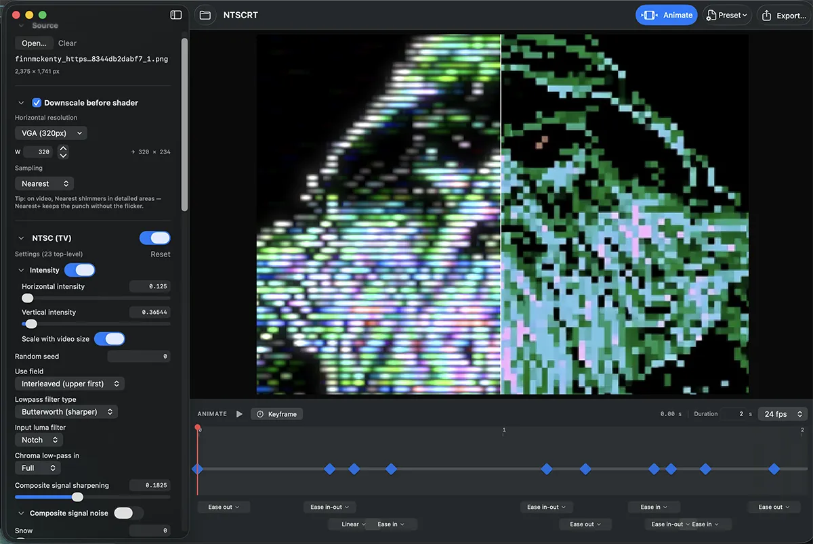

# NTSCRT



**Run video and images through simulated video gear, on Mac and Windows.** NTSCRT passes your media through a digital camera and its compression (webcam, video call, MiniDV), the TV signal ([ntsc-rs](https://github.com/ntsc-rs/ntsc-rs): composite artifacts, chroma bleed, noise), a VHS tape in a VCR, a TV set for the dramatic glitches, and a CRT screen (the shaders RetroArch uses, via [librashader](https://github.com/SnowflakePowered/librashader): scanlines, phosphor masks, glow). Each piece is simulated, so the effects combine the way real gear's did.

Full disclosure: the two hardest parts aren't mine. The signal emulation is ntsc-rs, and the CRT look is the RetroArch shader community's work. NTSCRT is the app built around them, native on Mac and on Windows: it joins them into one pipeline and adds its own pieces on top, including the Digital video, VCR and Glitch stages, Screen Loop video feedback, cropping, a keyframe timeline, video and GIF export, a command-line renderer, and an MCP server for AI apps.

**Works with Claude and other AI apps (MCP).** NTSCRT includes a built-in [MCP](https://modelcontextprotocol.io) server, so Claude Desktop, Claude Code, Cursor and other MCP clients can make analog video looks for you. Describe "a moldy rental tape in a dirty VCR, played on an old TV", and the AI previews frames, adjusts the VHS, CRT and glitch settings, animates them if you ask, and renders the video on your computer. One click sets it up: **NTSCRT > Connect to Claude…** on the Mac, **Help > Connect to Claude…** on Windows. See [Using NTSCRT from Claude](#using-ntscrt-from-claude-mcp).

```
your image/video → crop → digital camera + codec → NTSC/VHS signal (full res) → downscale to retro resolution → VHS tape and deck → TV glitches → CRT shader → screen
```

## Download

Grab the DMG from [**Releases**](../../releases/latest), open it, and drag **NTSCRT** to Applications.

**Requirements:** macOS 14 or later. The app is a universal binary (Apple Silicon + Intel).

**Windows (preview):** the same release has `NTSCRT-<version>-windows-x64.zip`.
- Unzip it anywhere and run `ntscrt.exe`. 64-bit Windows 10 or 11.
- It isn't code-signed yet, so Windows may warn about it: click **More info**, then **Run anyway**.
- Every feature of the Mac app except ProRes export, including the command line and the MCP server. Looks and presets are the same files on both.
- It's a preview: please open an issue if something misbehaves.

**Updates:** NTSCRT checks GitHub for a newer version once a day and offers to open its download page. Check for Updates… is in the NTSCRT menu on the Mac and the Help menu on Windows, where the daily check can be turned off. The check only asks GitHub for the latest version number.

> **Intel note:** I build and test NTSCRT on Apple Silicon and haven't personally tested the Intel build. Intel support exists thanks to a contributed fix ([#1](../../pull/1)) verified by its author on an Intel iMac Pro — if something misbehaves on your Intel Mac, please open an issue.

## Using the app

Open an image or video (⌘O, or drop it on the Source panel), shape the look in the sidebar, and export (⌘E).

### The pipeline (sidebar)

The sidebar runs top to bottom in signal order. A section's checkbox or switch turns that stage off.

- **Source**: the loaded image (PNG, JPEG, HEIC) or video (MP4, MOV).
- **Crop**: cuts the picture to an aspect ratio (square, or portrait and landscape shapes from 3:4 to 1:2) before anything else sees it. Drag the picture in the preview to move the crop, or a corner to zoom in (to cut black borders, say); double-click to center.
- **Downscale**: the retro resolution the CRT sees (SNES 256 px, VGA 320 px, or any width). **Chunky** keeps hard pixel edges; **Smooth** is softer and steadier on video.
- **Digital video** (off by default): a digital camera and codec ahead of the analog signal, like webcam footage dubbed to VHS. See [Digital video](#digital-video) below.
- **NTSC (TV)**: the analog signal, with composite noise, chroma bleed and about fifty more settings. They're ntsc-rs's own, so presets paste both ways with the [ntsc-rs app](https://github.com/ntsc-rs/ntsc-rs/releases). (Its VHS settings are retired: the VCR replaces them. Older looks that use them still render the same.)
- **VCR** (off by default): the picture recorded onto a simulated VHS tape and played back by a simulated deck. See [VCR](#vcr) below.
- **Glitch**: a simulated TV, for dramatic failures like rolling, tearing, bending and snow. The circuits themselves are simulated, so glitches combine the way real ones did. With every knob healthy, the picture is untouched.
  - **RF input** (Mac for now) sends the picture through the TV's antenna socket as a game console's signal, at the picture's own pixel scale: colored fringes on hard edges that crawl, and the tuner's noise.
  - **Edge crawl** adds crawling dots and harder outlines. **Color** sets the picture's own color, from black and white to garish.
  - **Tuner smear** trails the color to the right of what it colors. **Softness** blurs fine detail. **Tuner offset** mistunes the set: hazy, with color that weakens, wanders and drops out.
  - **Connection** picks a starting point: Direct, or RF clean, typical or rough. RF is boldest on a low Downscale (256 or 320 wide), as a console's picture was.
- **CRT**: seven RetroArch CRT shaders (crt-royale, crt-hyllian, crt-aperture, crt-easymode, two crtglow variants, crtsim) with every parameter exposed. A grayed-out control shows which switch turns it on.

### VCR

- **Pick a tape and a deck**: Brand new, Used, Worn out, Moldy, Vaselined, Chewed, Sticky or Bootleg; Clean, Dirty or Worn heads, Worn transport, or Neglected. Then adjust the knobs under each.
- **Nothing is drawn**: the picture is recorded as VHS records it (FM luminance, color-under) on the tape's slanted tracks, and read back through what the tape and heads are doing to it.
- **The tape is a real surface**: flaws, scratches, creases, mold and Vaseline sit at places on it, so they come back in the same spot, sweep through the picture as the heads cross them, and differ between cassettes (**Another**).
- **Each kind of damage has its own shape**: oxide flaws are dropouts, short dashes that start with a spark; scratches are thin lines at fixed heights; mold is bands of snow that tear the picture.
- **The heads have a history**: a shedding tape clogs an uncleaned deck as it plays; clogs knock loose; Vaseline rubs off onto the heads. Each head has its own dirt and wear, so alternate fields differ.
- **Spacing hurts detail first**: anything holding the heads off the tape costs the picture far more than the color, so the picture breaks into noise while the color smears on.
- **The tape moves for real**: a tracking servo follows the control track at the tape's bottom edge, so a chewed edge makes the tracking wander. Tension skews the top of the picture, a sticky tape grabs and lets go with a lurch, and a worn transport bends it into a slow wobble. Turning **Tracking** too far brings out noise bands, and **Search** sweeps the heads across the tracks.
- **Neighboring tracks bleed in**: the heads read their neighbors at the wrong azimuth, which mostly cancels the picture but not the color. The deck's comb filter cancels the color, at the cost of half its vertical detail.
- **SP, LP and EP**: slower speeds give narrower tracks, a slightly noisier picture, more crosstalk and less tolerance for tracking errors and skew; flaws last longer, since the tape moves slower.
- **Copies**: **Generation** dubs the picture from tape to tape up to three times, over a composite cable, recording and playing it back again each time.

### Digital video

Footage recorded digitally before it goes out as an analog signal. It runs real codecs, so blocks, smears and datamoshing come out of the compression rather than being drawn.

- **Formats** are in the toolbar's **Preset** menu, under Digital video: Webcam (2005), Video call, MiniDV (the VX1000 skate-video look), Early web video, CD-ROM (Video 1), and Datamosh. Each switches the stage on and sets its controls and the Downscale width.
- **Compression**: the **Codec** (DCT like MPEG and DV, or **Block colors**: Microsoft Video 1's flat two-tone 4×4 blocks and banded 15-bit color, the early CD-ROM look), quality, keyframe interval, fixed bitrate, plus color resolution and deblocking for DCT. **Color decode** set to Blocky repeats each color sample, as early DV decoders did: colored edges turn into steps.
- **Capture**: frame rate, sensor noise, **Low-light noise** (grain that grows in dark scenes as the camera turns up its gain), noise reduction, and **Aliasing**, which turns fine stripes into rainbow moiré. The broad rainbow bands need a source at least twice the Downscale width.
- **Sensor**: three chips (a 3-CCD camera), **One chip (webcam)** (a red, green and blue mosaic: false colors and a zipper pattern on fine detail), or **One chip (camcorder)** (how 90s one-chip camcorders read color: it lags a line, fringes at horizontal edges, and sharp detail picks up false color). With one chip, sensor noise turns into blotches of color. **Vertical smear** draws a pale streak up and down through lamps, headlights and the sun, strongest in dark scenes.
- **Fields**: **One field** (the default) sends the CRT one field: half the lines, each twice as tall, with a scanline per line (the 240p look). With the CRT off, each line shows twice. **Woven fields** shows both fields of an interlaced camera, so anything moving breaks into comb teeth; **Blended fields** mixes them into a ghosted double edge. Both need a clip with motion.
- **Picture**: **CCD response** gives a 90s camcorder's tone (bright exposure that leaves dark scenes dark, highlights that clip color by color, lens flare, and DV's milky gray blacks), plus white balance, tint, saturation and sharpening. **Halo width** sets how far the sharpening's outlines reach: tight for a pro camera's crunch, wide for a cheap camcorder's soft rims.
- **Errors**: data loss (DV dropouts, or packet-loss smears that last until the next keyframe) and, for DCT, datamosh, which needs a keyframe interval above 0.
- **Loss pattern** sets where data loss falls: stream packets, **DV tape** (stale blocks scattered in DV's own layout, and scratches that hold their pattern), or a **Clogged head**, which freezes every other band of the picture. **Lost blocks show** picks what fills the gaps: the last picture, gray, green, or the row above stretched down.
- **Bit errors** decode damaged data wrong: blocks of stripes and checks, bands of wrong brightness or color running along a row, rows landing out of place.
- **Added motion** (pan, tilt, zoom or swirl, with a speed) pushes the picture along with nothing to correct it, so it melts until the next keyframe. It works on still pictures too, which have no motion of their own to datamosh with.
- **Block size** (4, 8 or 16 px) sets the size of the codec's blocks whatever the resolution: bigger tiles for a large picture, a finer grit for a small one. Motion, lost data and datamoshing work in squares twice that size.
- **Bitrate limit** gives the codec a real budget of bits (shown in kbps), with a **Buffer** to borrow from. Once the buffer is spent, a cut or a keyframe lands as coarse blocks and sharpens over the next frames; starved further, the picture freezes for a moment. The Buffer needs a keyframe interval above 0.
- **Generations** compresses the picture again, up to 20 more times, moving the blocks a little each time: the mushy, color-bleeding look of a video re-uploaded over and over.

### Preview

- **Compare** splits the view: full pipeline on the left, the original on the right. Drag the line to move the split.
- **Integer scale** snaps the picture to whole-pixel multiples, for perfectly even scanlines.
- The **sparkles** button keeps tape noise and jitter moving. Leave it on for the real experience.
- Zoom with the slider or ⌥-scroll; hold Space and drag to pan. Zoomed in, the picture fills the whole preview, not just its own frame.
- Videos get a transport bar with play/pause and a frame-accurate scrubber. While a video is paused, the app renders ahead (the green line under the scrubber), so that stretch then plays back smoothly.
- A video's sound plays along with it. There are no controls: it follows play, pause, seeks and the loop at your computer's volume, and goes quiet while playback runs slower than real time.
- The palette fades when the mouse is idle; move the mouse to bring it back.

### Animating (timeline)

Click **Animate** in the toolbar to keyframe the whole effect chain, then export it as video.

- Move the playhead, set a look, and press **Keyframe**; repeat. Settings you don't change between keys hold still.
- With the playhead on a keyframe, any change you make updates that keyframe.
- Drag a diamond to retime it, and pick its easing (linear, ease in, ease out, ease in-out or hold) from the menu below it.
- Set the length and frame rate in the timeline. Changing the length stretches the whole animation.
- **Space** plays and pauses. On a video, the timeline *is* the clip: scrubbing seeks the footage.
- A still can export video even without keyframes; the tape noise and jitter move on their own.

### Exporting

Click **Export** (⌘E). Exports use the same switches as the preview, and the same settings always give the same pixels.

- **PNG**: the picture, or the frame under the playhead on a video.
- **Viewport**: exactly what the preview shows, zoom and all, at your screen's real pixels (2× on a Retina display). Use it for close-ups that show off the scanlines.
- **Video**: H.264 or HEVC .mp4, or ProRes .mov, with audio. Scanlines are hard on codecs, so use High quality or above, or ProRes for editing.
- **GIF**: its own width and frame rate. The panel estimates the file size and warns past about 10 MB (a 5-second, 480 px GIF is around 8 MB).
- **Loop** repeats the content inside the file (3 turns a 6-second clip into 18 seconds), for places that don't loop video.
- **An export is the picture in the preview**: the CRT is drawn once, at a size set by the picture going into it, and scaled to the window or the file.
- **Snap size to scanline grid** picks a nearby size where every scanline lands evenly.

### Screen Loop

Video feedback, the analog way: a camcorder filming a TV that shows the camcorder's own picture. The 1963 *Doctor Who* titles were made like this. Click **Screen Loop** in the toolbar.

- Your picture becomes a tunnel of copies. Each copy has been through your whole look once more than the one around it, so noise and color errors compound.
- Drag the green dot on the preview to set the vanishing point. Pull the blue ring out of it to make the point drift during the render.
- **Zoom** sets how deep the tunnel goes. Other knobs set the camera angle, handheld shake, push, spin, softness, color, and a luma key that keeps your subject solid.
- **Seamless loop** makes every move go out and back, so a GIF loops without a jump.
- A short draft re-renders as you work. **Render…** writes the full file with your export settings.
- Screen Loop presets are saved separately from looks.

### Presets

- **Preset** in the toolbar saves or loads your whole setup as a JSON file: every section, plus the timeline and its keyframes.
- The bundled presets are listed in the same menu. Loading one with keyframes opens the timeline.
- The **Digital video** formats at the bottom of the menu set only that section (and the Downscale width), leaving the rest of your look alone.
- A preset saved with a crop brings it back. One without a crop leaves yours alone.
- Presets from older versions open looking the way they did, even where a control has since changed.

### Command line and AI tools

- **`NTSCRT render`** renders without opening the window. Run it from inside the app bundle:
  ```sh
  /Applications/NTSCRT.app/Contents/MacOS/NTSCRT render clip.mp4 -o out.mp4 --look "90s VHS bootleg"
  ```
- **On Windows** use `ntscrt-cli.exe` from the NTSCRT folder in a terminal, with the same commands: `ntscrt-cli render clip.mp4 -o out.mp4 --look "90s VHS bootleg"`. (`ntscrt.exe` is the windowed app; scripts that read its output through a pipe can run it directly.)
- **Every section has flags**: `--look`, `--crop`, `--downscale`, `--digital`, `--ntsc`, `--glitch`, `--vcr`, `--tape`, `--deck`, `--crt`, each with a `-set key=value` partner (`--vcr-set tape_speed=EP,tracking_offset=0.4`). `NTSCRT help` lists them.
- **Output** follows the file name: .mp4, .mov (ProRes, Mac only), .gif, or .png. `--time 1,3,5` saves the frames at those times; a still becomes a video of `--duration` seconds.
- **`NTSCRT describe`** lists every control as JSON, with its range and what it does.
- **`NTSCRT looks`** lists the presets, tapes, decks and formats.

### Using NTSCRT from Claude (MCP)

NTSCRT can act as an MCP server: a background helper that gives an AI app new tools. Claude can then preview looks, adjust them, render videos and save presets for the app. Rendering happens on your computer; Claude sees only the preview frames it asks for.

**The easy way**: put NTSCRT in your Applications folder, open it, and choose **NTSCRT > Connect to Claude…**. Click **Connect** next to Claude Desktop or Claude Code, then quit and reopen Claude Desktop (**⌘Q**). NTSCRT backs up Claude's settings first and leaves your other servers alone.

**The easy way on Windows**: extract the NTSCRT folder somewhere it can stay (not inside the zip), open `ntscrt.exe`, and choose **Help > Connect to Claude…**. Connect as above, then quit Claude Desktop (including its icon in the system tray) and reopen it.

**Claude Desktop extension**: download `ntscrt-mcp-<version>.mcpb` from the [latest release](../../releases/latest) and double-click it (or drag it into Claude's **Settings > Extensions**). It needs NTSCRT in your Applications folder (on Windows: the NTSCRT folder unzipped somewhere it can stay, with `ntscrt.exe` opened once, so the extension can find it). NTSCRT is also listed in the official [MCP Registry](https://registry.modelcontextprotocol.io) as `io.github.finnmckenty/ntscrt`.

**Claude Desktop, by hand** (on Windows the command is the full path to `ntscrt.exe`, written with double backslashes: `"C:\\Tools\\NTSCRT\\ntscrt.exe"`)

1. Put NTSCRT in your Applications folder.
2. In Claude, open **Settings > Developer** and click **Edit Config**. Finder shows a file called `claude_desktop_config.json`; open it in TextEdit.
3. If the file is empty or only `{}`, replace everything with:
   ```json
   {
     "mcpServers": {
       "ntscrt": {
         "command": "/Applications/NTSCRT.app/Contents/MacOS/NTSCRT",
         "args": ["mcp"]
       }
     }
   }
   ```
   If it already has an `"mcpServers"` section, add the `"ntscrt": {…}` entry inside it, with a comma after the entry before it.
4. Save, quit Claude completely (**⌘Q**), and open it again. NTSCRT now shows in the chat's tools menu.

**Claude Code**: run `claude mcp add --scope user ntscrt -- /Applications/NTSCRT.app/Contents/MacOS/NTSCRT mcp` (on Windows, the path to `ntscrt.exe` instead).

**Other apps** that support MCP servers (Cursor, Windsurf, …) take the same command and `mcp` argument in their settings. ChatGPT can't: it only connects to servers on the internet.

**Using it**

- Give Claude the file's **path**, not an attachment: NTSCRT reads the file from your computer. In Finder, select the file and press **⌥⌘C** to copy its path; in File Explorer, press **Ctrl+Shift+C**.
- Then describe what you want: "Make /Users/me/Movies/skate.mp4 look like a moldy rental tape in a dirty VCR, played on an old TV." Claude previews a few frames, adjusts, and renders.
- It can animate too: "clean for two seconds, then the picture starts to roll and the tape gets chewed". It sets keyframes, as on the app's timeline, and saved looks open with them.
- **Stills come alive**: give it a still (line drawings, lettering and logos work especially well) and ask for an animated GIF or a seamless loop. Or ask for "twenty variations" and it renders a wildly varied timeline and saves stills from it.
- Claude asks before using each tool the first time; allow it.
- Videos go to `~/Movies/NTSCRT` (Windows: `Videos\NTSCRT`) unless you say where; saved presets go to its `Looks` folder and open with **Preset > Load Preset…** (Windows: **Preset > Load…**).

### Tips

- Every number next to a slider is a text field: click it and type.
- Double-click a slider's knob to reset it.
- Analog artifacts show best on contrast: dark backgrounds, bright sprites, hard edges.
- For high-resolution sources, turn on **Intensity → Scale with video size** in the NTSC panel, so artifacts keep their size.
- Scanlines need room: each line needs three or more screen pixels to show. If they vanish, especially on tall or portrait clips, lower the Downscale width, use One field, or zoom in.

## Limitations

- The Intel half of the universal build is community-tested, not author-tested (see the note up top).
- The NTSC stage runs on the CPU at your source's full resolution, so 4K sources slow the preview down. Exports always render every frame.
- Video playback runs in real time and drops the occasional frame under heavy settings. The render-ahead cache holds up to a quarter of memory (at most 1 GB).
- Screen Loop doesn't apply the Digital video stage yet.
- Some CRT shaders, like crt-hyllian, switch their scanlines off for pictures taller than about 400 lines, treating them as interlaced.
- A few crt-royale parameters are switched off inside the shader itself (marked "static in this shader build"). They do nothing in RetroArch either.
- No undo. Save a preset before big experiments.

## Building from source

See [DEVELOPMENT.md](DEVELOPMENT.md) for the full developer setup (Swift + Rust toolchains, vendored dependencies, CLI tools, release pipeline).

## Credits

- [ntsc-rs](https://github.com/ntsc-rs/ntsc-rs) — the NTSC/VHS signal emulation (MIT/ISC/Apache-2.0)
- [librashader](https://github.com/SnowflakePowered/librashader) by SnowflakePowered — the RetroArch-compatible shader runtime (MPL-2.0)
- [vhs-decode](https://github.com/oyvindln/vhs-decode) — the VHS format numbers (carriers, emphasis, filters) the VCR simulation is built to (GPL-3.0; numbers only, no code)
- [analogtv](https://www.jwz.org/xscreensaver/) by Trevor Blackwell (xscreensaver) — the design the Glitch stage's receiver simulation follows: glitches as the response of simulated TV circuits
- [libretro/slang-shaders](https://github.com/libretro/slang-shaders) and the RetroArch community — the CRT shaders themselves: crt-royale by TroggleMonkey, crt-easymode and crt-aperture by EasyMode, crt-hyllian by Hyllian, crtsim, crtglow (various licenses, largely GPL)

## License

NTSCRT is released under the [MIT License](LICENSE): use it, change it, and share it, including commercially, as long as the copyright notice comes along.

The bundled ntsc-rs, librashader and RetroArch shaders keep their own licenses. [THIRD_PARTY_NOTICES.md](THIRD_PARTY_NOTICES.md) lists them, and the full texts ship inside the app.
